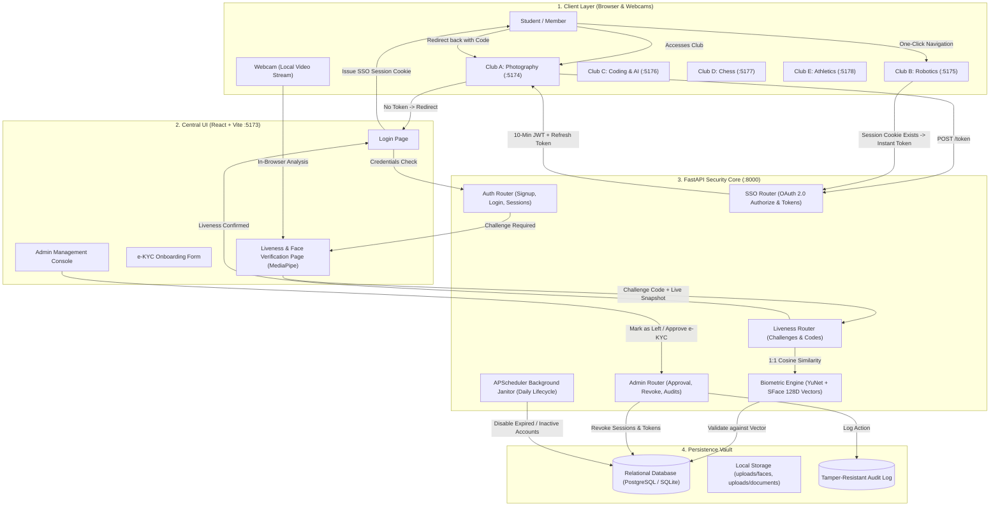

# 📚 Sankalp SSO ("Real Person, Real Access") — Documentation Hub

Welcome to the comprehensive documentation repository for **Sankalp SSO**. 

This system was engineered by **Team Sankalp** (Shreyans Dey & Arka Paul) for **Hack N Pitch 2026** at Jadavpur University (Track: *Cybersecurity & Digital Identity*).

---

## 🌟 1. System Overview: What is Sankalp SSO?

### 1.1. The Plain English Analogy (For Complete Beginners)
Imagine entering a modern university campus:
1. **The Old Way (Without SSO & Liveness)**:
   - Every single classroom, laboratory, sports club, and library has its own lock and key.
   - You must memorize 10 different passwords for 10 different doors.
   - If someone steals your notebook where you wrote down your passwords, they can unlock all doors without anyone knowing who is really opening them.
   - When a student graduates or leaves the college, the administration forgets to change the locks on the robotics lab or photo studio. That graduate can keep entering campus facilities months or years later!
   - Anyone can hold up a paper photo of a student to a security guard and sneak in.

2. **The Sankalp Way ("Real Person, Real Access")**:
   - **One Central Security Gate (Single Sign-On / SSO)**: You verify yourself once at the campus main entrance (`http://localhost:5173`). Once passed, you receive a digital badge. You can now walk into any connected club (Photography, Robotics Lab, Coding & AI, Chess Club, Athletics) with **one single click**—no repeated passwords!
   - **A Real Living Human (Liveness Detection)**: The security camera checks that a real, living, 3D person is standing in front of it (by having you turn your head and blink naturally twice). Holding up a printed photograph or playing a smartphone video fails immediately.
   - **Biometric Identity Verification (1:1 Face Match)**: Not only must you be alive, but your face must mathematically match the student ID profile verified during registration.
   - **Immediate Revocation ("Mark as Left")**: When a student graduates or leaves, the campus administrator clicks **"Mark as left"**. In less than 0.2 seconds, access across **all 5 club facilities is terminated instantly**.
   - **Automatic Cleanup**: If a student's term ends or they stop logging in for 60 days, background janitor software automatically locks the account so no forgotten "ghost accounts" remain.
   - **Admin Biometric Face Lock**: The administrator console can be strictly locked behind facial biometrics, supporting multi-admin face profiles to prevent unauthorized takeover even if the admin password is leaked.
   - **Real-Time Security Email Alerts**: Users receive instant email notifications on every successful login and password change, with IP address, browser User-Agent, and Indian Standard Time (IST) timestamps.

---

## 🗺️ 2. High-Level System Architecture & Visual Pipeline

The entire system is composed of four main layers:
1. **The User & Campus Clubs (Client Side)**: Web browser, connected web applications, and webcam.
2. **The Central Identity Provider (Frontend)**: React + Vite application hosting the Login, e-KYC Onboarding, Liveness Screen, and Admin Console.
3. **The Core Security Server (Backend)**: High-performance Python FastAPI engine handling authentication, cryptography, biometric mathematics, and token issuance.
4. **Data & Storage Vault (Persistence)**: SQLite/PostgreSQL relational database storing hashed credentials, 128D mathematical vectors, and an immutable audit trail, alongside local encrypted file storage for administrative verification.



---

## 🔄 3. End-to-End User Lifecycle Pipeline

Below is the complete journey of a member from their first day joining a university club until graduation and account closure:

```mermaid
sequenceDiagram
    autonumber
    actor Student as Student (Member)
    actor Admin as Campus Administrator
    participant System as Sankalp SSO Core
    participant Clubs as Connected Campus Clubs

    Note over Admin, Student: Stage 1: Invitation & e-KYC Onboarding
    Admin->>System: 1. Generate Invite Token with Term End Date
    System-->>Student: 2. Invite link sent to Student
    Student->>System: 3. Submit name, password, webcam photo, & student ID card
    System->>System: 4. Extract 128D face embedding; account set to 'pending_approval'
    
    Note over Admin, System: Stage 2: Admin Human-in-the-Loop Review
    Admin->>System: 5. Inspect webcam snapshot vs. uploaded student ID card
    Admin->>System: 6. Click "Approve & Activate"
    System->>System: 7. Account status transitioned to 'active'

    Note over Student, Clubs: Stage 3: Daily Login & Physical Liveness
    Student->>Clubs: 8. Open Photography Club (:5174)
    Clubs->>System: 9. Redirect to Central Login (:5173)
    Student->>System: 10. Enter Email & Password
    System->>Student: 11. Request Random Liveness Challenge (e.g. Turn Right + 2 Blinks)
    Student->>System: 12. Complete physical head movement & natural eye blinks
    System->>System: 13. Verify 30s one-time code + 1:1 SFace biometric match (>= 0.40)
    System->>Student: 14. Set HttpOnly sso_session cookie
    System->>Clubs: 15. Redirect with 60-second authorization code
    Clubs->>System: 16. Exchange code for 10-minute JWT access token
    Clubs-->>Student: 17. Access Granted: Welcome to Photography Club!

    Note over Student, Clubs: Stage 4: One-Click Single Sign-On (SSO)
    Student->>Clubs: 18. Open Robotics Lab (:5175)
    Clubs->>System: 19. Check SSO session cookie
    System-->>Clubs: 20. Session is Active! Issue instant authorization code (No camera, no password)
    Clubs-->>Student: 21. Access Granted instantly!

    Note over Admin, Clubs: Stage 5: Offboarding & Instant Access Termination
    Admin->>System: 22. Click "Mark as Left" on Student
    System->>System: 23. Atomic revocation of all sessions and refresh tokens (<0.2s)
    Student->>Clubs: 24. Refresh any club tab
    Clubs-->>Student: 25. Bright Red ACCESS DENIED! Access terminated everywhere.
```

---

## 📖 4. Documentation Directory Guide

All project documentation is structured into two main folders:
1. `docs/specs/`: High-level system blueprints, security rules, data dictionaries, API manuals, and execution plans.
2. `docs/modules/`: In-depth implementation documentation for every code module in the system, featuring full code listings, line-by-line breakdowns, test procedures, and known boundaries.

### 4.1. System Specifications (`docs/specs/`)

| Document | Purpose | Key Content |
|---|---|---|
| [**srs.md**](file:///docs/specs/srs.md) | Software Requirements Specification | Problem statement, user personas, requirements (M1–M10, FR1–FR10), performance metrics, and success criteria. |
| [**architecture.md**](file:///docs/specs/architecture.md) | Technical System Architecture | Component diagrams, OAuth 2.0 authorization code flow, token lifecycles, and security boundary isolation. |
| [**data-model.md**](file:///docs/specs/data-model.md) | Relational Database & Entity Schemas | ER diagrams, table definitions (`users`, `invites`, `products`, `sso_sessions`, `auth_codes`, `refresh_tokens`, `liveness_challenges`, `password_reset_tokens`, `audit_log`), and data dictionaries. |
| [**api.md**](file:///docs/specs/api.md) | REST API Reference Manual | Endpoints, HTTP methods, authentication headers, request/response JSON schemas, error codes, and step-by-step logic. |
| [**security.md**](file:///docs/specs/security.md) | Security, Privacy & Threat Model | Threat analysis, anti-spoofing defense mechanisms, password hashing (Argon2), unit vectors, privacy guarantees, and honest limits. |
| [**build-plan.md**](file:///docs/specs/build-plan.md) | Phase-by-Phase Development Schedule | Milestone roadmap, time allocations, checkpoints, and risk mitigation strategies. |
| [**stack-and-setup.md**](file:///docs/specs/stack-and-setup.md) | Technology Stack & Setup Guide | Prerequisites, virtual environment creation, package installation, port allocations, and startup commands. |
| [**demo-script.md**](file:///docs/specs/demo-script.md) | 4-Minute Presentation Walkthrough | Step-by-step judge demonstration flow, script prompts, and answers to likely technical questions. |
| [**test-checklist.md**](file:///docs/specs/test-checklist.md) | Verification & Quality Assurance | Pre-flight test matrix covering SSO, e-KYC, liveness, cleanup jobs, and audit security. |
| [**todos.md**](file:///docs/specs/todos.md) | Project Milestone Checklist | Chronological tracking of completed features and deliverables. |

---

### 4.2. Module Implementations (`docs/modules/`)

| # | Module | Document | Description |
|---|---|---|---|
| 00 | Master Index | [**00-index.md**](file:///docs/modules/00-index.md) | Overview table tracking status, owners, key files, and dependencies of all system modules. |
| 01 | Auth Core | [**01-auth-core.md**](file:///docs/modules/01-auth-core.md) | Signup, self-registration, Argon2 password hashing, central sessions, and SMTP password reset. |
| 02 | SSO Flow | [**02-sso-flow.md**](file:///docs/modules/02-sso-flow.md) | OAuth 2.0 Authorization Code exchange, 10-min JWTs, revocable refresh tokens, and 1-click cross-app switching. |
| 03 | Liveness Check | [**03-liveness.md**](file:///docs/modules/03-liveness.md) | MediaPipe Face Mesh, Eye Aspect Ratio (EAR), 3D Z-depth variance, yaw calibration, and anti-jitter blink detection. |
| 04 | Admin Dashboard | [**04-admin-dashboard.md**](file:///docs/modules/04-admin-dashboard.md) | Member directory, instant "Mark as Left" revocation, 30-day deletion safeguards, and product management. |
| 05 | Cleanup Job | [**05-cleanup-job.md**](file:///docs/modules/05-cleanup-job.md) | APScheduler background worker, term end date expiration, 60-day inactivity policies, and atomic revocations. |
| 06 | Audit Log | [**06-audit-log.md**](file:///docs/modules/06-audit-log.md) | Tamper-resistant audit trail, 20 fixed audit actions, PII/secret scrubbing, and query inspectors. |
| 07 | Demo Apps | [**07-demo-apps.md**](file:///docs/modules/07-demo-apps.md) | 5 connected university campus clubs (ports 5174–5178), multi-port runner, OAuth client flow, and denial states. |
| 08 | e-KYC & Biometrics | [**08-ekyc-face-verification.md**](file:///docs/modules/08-ekyc-face-verification.md) | Institutional e-KYC onboarding, OpenCV YuNet face detection, SFace 128D deep vector embedding extraction, and 1:1 Cosine Similarity matching ($\ge 0.40$). |
| 09 | System Overview & Pitch | [**09-system-overview-and-pitch.md**](file:///docs/modules/09-system-overview-and-pitch.md) | Master system architecture analysis, competitive market matrix, corporate sponsorship ROI, judge conviction criteria, and 12-slide Claude PPTX presentation script. |

---

## 🧠 5. Glossary of Concepts (For Absolute Beginners)

If you have never written a line of code or studied computer security, these simple definitions explain the core concepts used across the documentation:

1. **Single Sign-On (SSO)**: A technology that lets you log in once with one master username and password, granting access to multiple connected applications without typing your credentials again.
2. **Access Token**: A temporary digital ticket (lasting only 10 minutes) that a connected club uses to verify that you are allowed inside.
3. **Refresh Token**: A long-term digital key stored securely that allows an application to ask for a new 10-minute access token without asking you to log in again, as long as your account is still active.
4. **JSON Web Token (JWT)**: A digitally signed, tamper-proof electronic document that contains basic user details (like your User ID, Email, and Role) that applications can read and trust without constantly asking the database.
5. **Cryptographic Hashing (Argon2 / SHA-256)**: A one-way mathematical blender. You can turn a password or token into an unreadable scramble of characters (a "hash"), but nobody—not even a hacker who steals the database—can un-blend the hash back into your original password.
6. **Liveness Detection**: A security test that proves a live, physically present human being is standing before the camera, rather than a printed photograph, a laptop screen playing a video, or an automated bot.
7. **Eye Aspect Ratio (EAR)**: A simple geometric formula comparing the vertical height of an eye to its horizontal width. When you blink, the vertical height drops to near zero, allowing software to detect real blinks mathematically.
8. **e-KYC (electronic Know Your Customer)**: The process of verifying a person's physical identity and institutional affiliation (using a student ID card and webcam snapshot) before activating their account.
9. **Face Embedding (128D Vector)**: A list of 128 mathematical numbers generated by an AI neural network that describes the unique geometric landmarks of a person's face. No human face picture is stored—only the 128 numbers!
10. **Cosine Similarity**: A high school geometry calculation that measures the angle between two lists of numbers. If the angle is very small (cosine similarity $\ge 0.40$), the two faces belong to the same person.
11. **HttpOnly Cookie**: A secure digital note stored in your browser that cannot be stolen by malicious JavaScript code, making it immune to common website attacks (XSS).
12. **APScheduler**: An automated alarm clock that runs inside Python every day to check if any student's membership has expired and turn off their access automatically.
