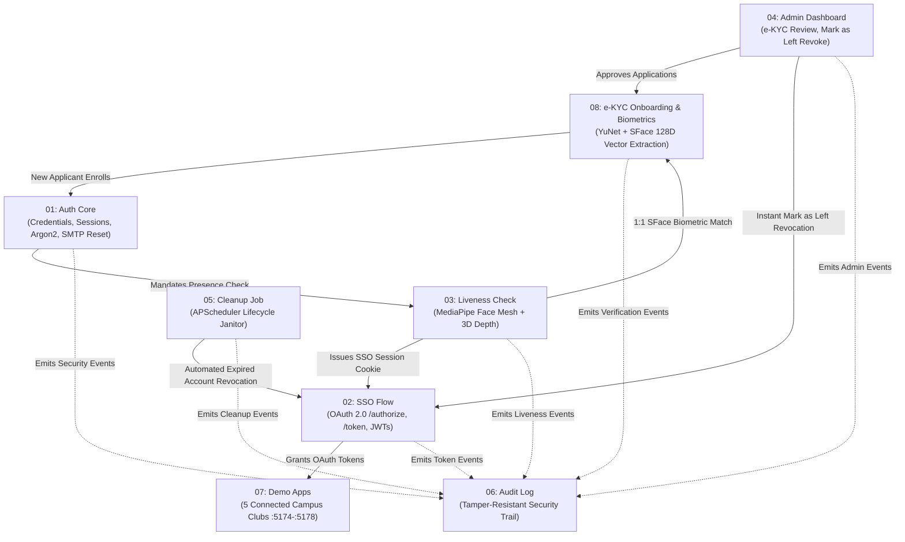

# 00 — Module Index & Technical Implementation Catalog

Welcome to the implementation catalog for **Sankalp SSO**. Every core capability in the system is isolated into a dedicated, self-contained module documented in accordance with `_module-template.md`.

---

## 📑 1. Master Module Registry

| Module # | Module Name | Primary Code Files | Status | Owner | Test Coverage |
|---|---|---|---|---|---|
| [**01**](file:///docs/modules/01-auth-core.md) | **Auth Core** (Signup, Login, Sessions, Argon2, Password Reset) | `backend/app/routes/auth.py` `backend/app/security.py` `backend/app/services/email_service.py` | **Done** | Shaan | `backend/tests/test_auth.py` |
| [**02**](file:///docs/modules/02-sso-flow.md) | **SSO Flow** (Authorize, Tokens, 60s Codes, Refresh, 1-Click SSO) | `backend/app/routes/sso.py` `backend/app/deps.py` | **Done** | Shaan | `backend/tests/test_sso.py` |
| [**03**](file:///docs/modules/03-liveness.md) | **Liveness Check** (MediaPipe Face Mesh, 3D Depth, Anti-Jitter Blink) | `frontend/src/pages/Liveness.jsx` `backend/app/routes/liveness.py` | **Done** | Arka | `frontend/src/pages/Liveness.jsx` |
| [**04**](file:///docs/modules/04-admin-dashboard.md) | **Admin Dashboard** (Member Management, Instant Mark as Left, 48h Renewals Desk) | `frontend/src/pages/Admin.jsx` `frontend/src/pages/Renew.jsx` `backend/app/routes/admin.py` | **Done** | Arka | `backend/tests/test_admin_and_cleanup.py` `backend/tests/test_renewal_and_48h_purge.py` |
| [**05**](file:///docs/modules/05-cleanup-job.md) | **Cleanup Job** (APScheduler Janitor, Term Expiry, 48h Hard Purge) | `backend/app/jobs/cleanup.py` | **Done** | Shaan | `backend/tests/test_admin_and_cleanup.py` `backend/tests/test_renewal_and_48h_purge.py` |
| [**06**](file:///docs/modules/06-audit-log.md) | **Audit Log** (Append-Only Trail, 20 Fixed Actions, PII Scrubber) | `backend/app/audit.py` | **Done** | Shaan | `backend/tests/test_admin_and_cleanup.py` |
| [**07**](file:///docs/modules/07-demo-apps.md) | **Demo Apps** (5 Connected Campus Clubs: Ports 5174–5178) | `demo-apps/serve_demo_apps.py` `demo-apps/app-[a-e]/index.html` | **Done** | Shaan & Arka | End-to-End Browser Tests |
| [**08**](file:///docs/modules/08-ekyc-face-verification.md) | **e-KYC & Biometrics** (YuNet + SFace 128D Vectors, Cosine Match $\ge 0.40$) | `backend/app/services/face_engine.py` `frontend/src/pages/Register.jsx` | **Done** | Arka & Shaan | `backend/tests/test_ekyc_and_biometrics.py` `backend/test_full_system.py` |

---

## 🗺️ 2. Architectural Module Interdependencies

The diagram below illustrates how each module interfaces with the others across client, API, and persistence layers:

---

## 🎯 3. Definition of Done (Module Quality Standard)

Under project rules (`AGENTS.md`), a module is classified as **Done** only when:
1. The source code compiles, executes, and passes all relevant unit tests.
2. All test cases specified in `docs/specs/test-checklist.md` pass without regression.
3. A dedicated markdown file exists in `docs/modules/` containing:
   - Layman explanation of purpose and approach.
   - Detailed visual workflow / pipeline diagrams.
   - Complete, verbatim code listings for primary files.
   - Line-by-line / block-by-block functional breakdown.
   - Step-by-step instructions for running and verifying the module.
   - Honest architectural boundaries and future roadmap items.
4. The corresponding milestones in `docs/specs/todos.md` are checked.
