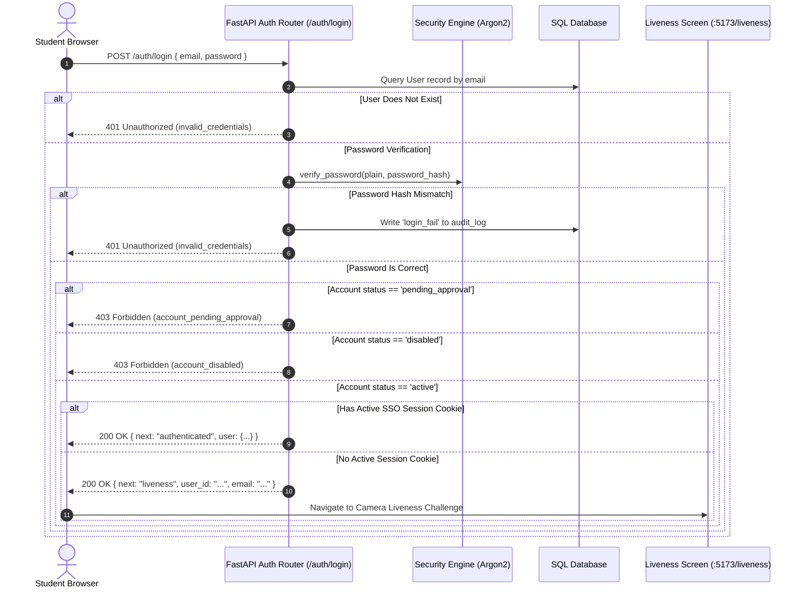
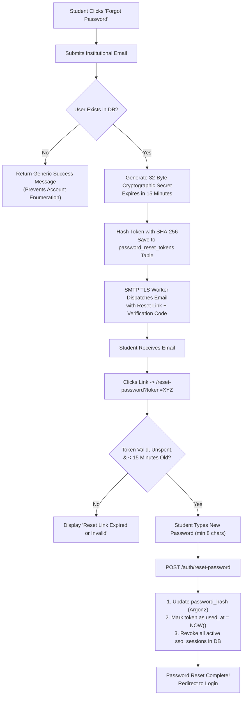
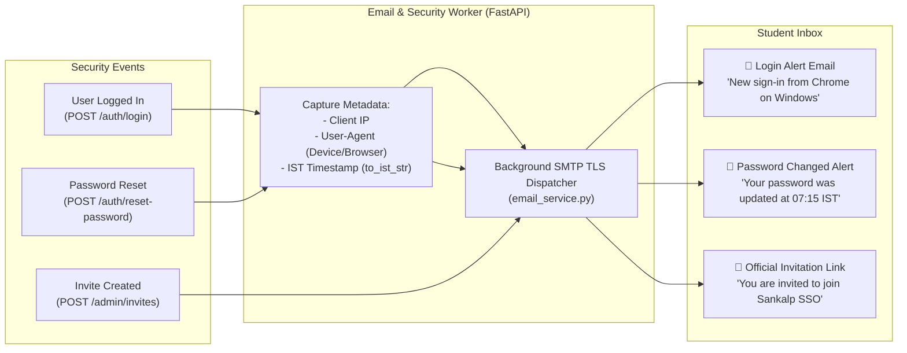

# 01 — Auth Core (Signup, Login, Sessions & Password Reset)

**Status:** Done · **Owner:** Shaan (Backend Lead) · **Date:** 2026-11-20  
**Primary Source Files:**  
- `backend/app/routes/auth.py`
- `backend/app/security.py`
- `backend/app/models.py`
- `backend/app/services/email_service.py`

---

## 🌟 1. What it is (Plain Words / Layman Explanation)

The **Auth Core** is the digital front door of the entire university SSO system. 
Think of it like the **Main Admissions and Registrar Office** of a university campus:
1. **Joining the University (Signup & e-KYC)**: You cannot just walk in off the street and claim to be a student. An administrator must invite you, or you must submit an official application with your student ID card and webcam snapshot.
2. **Password Blender (Argon2 Hashing)**: When you create a password, the system never writes down your actual password. Instead, it drops it into a mathematical "blender" called **Argon2id**. Even if a thief somehow breaks into the university database, all they find is a scrambled, unreadable string of characters.
3. **Checking Your Credentials (Login)**: When you sign in, the system blends the password you just typed and checks if it matches the scrambled version on file. If your account has been approved by the dean, it lets you proceed to the biometric camera check.
4. **The Central Visitor Badge (SSO Session Cookie)**: Once you prove who you are, the server hands your browser a secure digital badge (`sso_session` cookie). As long as you hold this badge, you can open connected campus clubs without typing your password again.
5. **Emergency Key Replacement (Forgot Password)**: If you forget your password, the system emails you a secure, single-use 15-minute reset code via university email. Resetting your password immediately destroys all active visitor badges everywhere to protect your account.
6. **Automated Login & Password Security Alerts**: Every successful sign-in asynchronously dispatches an alert email containing the client IP, browser User-Agent, and Indian Standard Time (IST) timestamp. Resetting passwords triggers an immediate security alert warning the user of the modification, while permanently invalidating the previous password and tearing down all active sessions.
7. **Direct Email Invitations**: Pre-authorized invitation links created by administrators are automatically delivered to the candidate's inbox via institutional SMTP.

---

## 🎯 2. Why it exists (Requirements Coverage)

This module implements the following core specifications from `docs/specs/srs.md`:
- **M1**: Invite-based signup and e-KYC onboarding.
- **M2**: Secure authentication with email and password.
- **FR1**: Enforcing account states (`pending_approval`, `active`, `disabled`, `deleted`). Logout terminates sessions without altering account records.
- **FR4**: Dual-token infrastructure support and token hashing.
- **FR9**: e-KYC gating preventing unapproved applicant logins.
- **FR12**: Automated security notifications (login alerts, password change alerts, automated invite delivery) and universal Indian Standard Time (IST) timestamping.

---

## 🔄 3. How it works (Architectural Workflows & Visual Pipelines)

### 3.1. User Sign-In & Session Establishment Pipeline



---

### 3.2. Self-Service Password Recovery Workflow



---

### 3.3. Automated Security Alert & Notification Pipeline



---

## 💻 4. Key Source Code

### 4.1. Cryptographic Security Engine (`backend/app/security.py`)

```python
import hashlib
import secrets
import uuid
from datetime import datetime, timedelta
from typing import Optional, Dict, Any
import jwt
from argon2 import PasswordHasher
from argon2.exceptions import VerifyMismatchError, VerificationError
from app.config import JWT_SECRET, ACCESS_TOKEN_MINUTES, SSO_SESSION_HOURS

# Configure memory-hard Argon2id hasher
ph = PasswordHasher(
    time_cost=2,
    memory_cost=65536,  # 64 MB of RAM per hash
    parallelism=1,
    hash_len=32,
    salt_len=16
)

def hash_password(password: str) -> str:
    """Hash a plaintext password using Argon2id."""
    return ph.hash(password)

def verify_password(plain_password: str, hashed_password: str) -> bool:
    """Verify a plaintext password against an Argon2id hash."""
    try:
        return ph.verify(hashed_password, plain_password)
    except (VerifyMismatchError, VerificationError):
        return False

def hash_token(token: str) -> str:
    """
    Hash a secret token (one-time code, refresh token, invite token)
    using SHA-256 for deterministic, constant-time database lookup.
    """
    return hashlib.sha256(token.encode("utf-8")).hexdigest()

def generate_random_token(length: int = 32) -> str:
    """Generate a cryptographically secure URL-safe random string."""
    return secrets.token_urlsafe(length)

def generate_liveness_code() -> str:
    """Generate a short 6-8 character one-time code for liveness."""
    return secrets.token_hex(4).upper()

def create_access_token(user_id: str, email: str, role: str) -> str:
    """
    Create a signed JWT access token valid for 10 minutes.
    Contains sub (user_id), email, role, and jti (unique token UUID).
    """
    now = datetime.utcnow()
    payload = {
        "sub": user_id,
        "email": email,
        "role": role,
        "jti": str(uuid.uuid4()),
        "iat": now,
        "exp": now + timedelta(minutes=ACCESS_TOKEN_MINUTES)
    }
    return jwt.encode(payload, JWT_SECRET, algorithm="HS256")
```

---

### 4.2. Core Authentication Router (`backend/app/routes/auth.py` - Extracts)

```python
@router.post("/login")
def login(
    payload: LoginRequest,
    request: Request,
    response: Response,
    db: Session = Depends(get_db),
    existing_session: Optional[SsoSession] = Depends(get_current_session)
):
    """
    M2: Central credentials authentication.
    Verifies email and password; checks account status; determines if liveness is required.
    """
    user = db.query(User).filter(User.email == payload.email.strip().lower()).first()

    if not user or not verify_password(payload.password, user.password_hash):
        log_audit(db, action="login_fail", actor_id=user.id if user else None, detail={"email": payload.email})
        raise HTTPException(
            status_code=status.HTTP_401_UNAUTHORIZED,
            detail={"error": "invalid_credentials", "message": "Invalid email or password"}
        )

    # FR9 Gating: Block unapproved applicants
    if user.status == "pending_approval":
        raise HTTPException(
            status_code=status.HTTP_403_FORBIDDEN,
            detail={"error": "account_pending_approval", "message": "Your e-KYC application is awaiting administrator approval."}
        )

    # FR1/FR2 Gating: Block disabled or deleted accounts
    if user.status != "active":
        log_audit(db, action="access_denied", actor_id=user.id, detail={"status": user.status})
        raise HTTPException(
            status_code=status.HTTP_403_FORBIDDEN,
            detail={"error": "account_disabled", "message": f"Account is {user.status}"}
        )

    # FR8: If user already possesses an active central SSO session, bypass liveness check
    if existing_session and existing_session.user_id == user.id:
        user.last_active_at = datetime.utcnow()
        db.commit()
        log_audit(db, action="login_ok", actor_id=user.id, detail={"method": "existing_session"})
        return {
            "status": "ok",
            "next": "authenticated",
            "user": {"id": user.id, "email": user.email, "name": user.name, "role": user.role}
        }

    # First sign-in or expired session: Enforce liveness check
    return {
        "status": "ok",
        "next": "liveness",
        "user_id": user.id,
        "email": user.email
    }


@router.post("/forgot-password")
def forgot_password(payload: ForgotPasswordRequest, db: Session = Depends(get_db)):
    """Dispatches a single-use 15-minute reset token via institutional SMTP."""
    user = db.query(User).filter(User.email == payload.email.strip().lower()).first()
    if user and user.status == "active":
        raw_token = generate_random_token(32)
        token_h = hash_token(raw_token)
        expires_at = datetime.utcnow() + timedelta(minutes=15)

        reset_entry = PasswordResetToken(
            user_id=user.id,
            token_hash=token_h,
            expires_at=expires_at
        )
        db.add(reset_entry)
        db.commit()

        reset_url = f"{FRONTEND_ORIGIN}/reset-password?token={raw_token}"
        send_password_reset_email(user.email, user.name, reset_url, raw_token)
        log_audit(db, action="password_reset_requested", actor_id=user.id)

    return {"status": "ok", "message": "If an active account exists, password reset instructions have been dispatched."}


@router.post("/reset-password")
def reset_password(payload: ResetPasswordRequest, db: Session = Depends(get_db)):
    """Updates password with Argon2, invalidates active sessions, marks token spent."""
    token_h = hash_token(payload.token)
    reset_entry = db.query(PasswordResetToken).filter(
        PasswordResetToken.token_hash == token_h,
        PasswordResetToken.used_at.is_(None),
        PasswordResetToken.expires_at > datetime.utcnow()
    ).first()

    if not reset_entry:
        raise HTTPException(
            status_code=status.HTTP_400_BAD_REQUEST,
            detail={"error": "invalid_reset_token", "message": "Password reset token is invalid, expired, or already used."}
        )

    user = db.query(User).filter(User.id == reset_entry.user_id).first()
    user.password_hash = hash_password(payload.password)
    reset_entry.used_at = datetime.utcnow()

    # Invalidate all active central SSO sessions for security
    db.query(SsoSession).filter(
        SsoSession.user_id == user.id,
        SsoSession.revoked_at.is_(None)
    ).update({"revoked_at": datetime.utcnow()})

    db.commit()
    log_audit(db, action="password_reset_completed", actor_id=user.id)
    return {"status": "ok", "message": "Password updated successfully. You may now log in with your new credentials."}
```

---

## 🔍 5. Code Explanation (Block-by-Block for Freshers)

1. **`PasswordHasher(memory_cost=65536, time_cost=2)`**:
   - `memory_cost=65536` forces the computer to reserve 64 Megabytes of RAM just to compute a single password hash.
   - While a normal server can easily do this in 0.1 seconds, a hacker attempting to test billions of stolen passwords using specialized GPU clusters runs out of memory, rendering password cracking attacks mathematically impossible.
2. **`hash_token(token)`**:
   - Uses standard SHA-256 to convert arbitrary strings (like invite codes or reset tokens) into a fixed 64-character hexadecimal digest.
   - This ensures the database never stores plaintext tokens. If a token is submitted by a user, the server hashes the input and searches for the hash in $O(1)$ constant time.
3. **`login(...)` Account Status Gating**:
   - If `user.status == "pending_approval"`, the system returns HTTP 403 `account_pending_approval`. The student cannot access campus clubs until an admin verifies their institutional documents.
   - If `user.status == "disabled"`, the system returns HTTP 403 `account_disabled`.
   - If credentials are valid, the server checks if the browser already has an active, unrevoked `sso_session` cookie. If yes, it skips camera verification and returns `next: "authenticated"`. If no, it routes the user to `next: "liveness"`.
4. **`forgot_password(...)` Account Enumeration Mitigation**:
   - Whether the email exists in the database or not, the endpoint returns the exact same success response. This prevents malicious reconnaissance bots from discovering which professor or student emails exist in the database.
5. **`reset_password(...)` Session Revocation**:
   - When a password is changed, an attacker who previously hijacked an active session cookie must not remain logged in. The endpoint queries all rows in `sso_sessions` belonging to that user and sets `revoked_at = NOW()`, instantly kicking all active sessions out.

---

## 🧪 6. How to Run and Test It

### 6.1. Automated Test Suite
Execute the dedicated authentication unit tests:
```bash
pytest backend/tests/test_auth.py -v
```

### 6.2. Manual API Testing via `curl`
```bash
# 1. Attempt login with wrong password (Expects 401 Unauthorized)
curl -X POST http://localhost:8000/auth/login \
  -H "Content-Type: application/json" \
  -d "{\"email\":\"rahul@ju.edu\",\"password\":\"WrongPassword!\"}"

# 2. Attempt login with correct password (Expects next: "liveness")
curl -X POST http://localhost:8000/auth/login \
  -H "Content-Type: application/json" \
  -d "{\"email\":\"rahul@ju.edu\",\"password\":\"RahulPass123!\"}"

# 3. Request password reset
curl -X POST http://localhost:8000/auth/forgot-password \
  -H "Content-Type: application/json" \
  -d "{\"email\":\"rahul@ju.edu\"}"
```

**Satisfied Test Checklist Items:**
- [x] Signup from valid invite works; expired or spent invites refused.
- [x] Login with invalid password fails and writes `login_fail` to audit log.
- [x] Unapproved applicant blocked with `403 account_pending_approval`.
- [x] Disabled member blocked with `403 account_disabled`.
- [x] Forgot password issues 15-minute single-use token via SMTP.
- [x] Reset password updates Argon2 hash and invalidates active sessions.

---

## ⚠️ 7. Known Limits & Future Work

1. **Multi-Factor Authentication (TOTP / Hardware Tokens)**:
   - The current architecture couples passwords with physical 3D camera liveness. Support for time-based one-time password (TOTP) apps (Google Authenticator) or FIDO2 WebAuthn USB keys is planned for high-security laboratory environments.
2. **Account Lockout on Consecutive Failures**:
   - Currently, failed logins are recorded in `audit_log`. Adding automated IP/account progressive exponential backoff (e.g. 5 failed attempts locks account for 15 minutes) is planned for enterprise production hardening.
