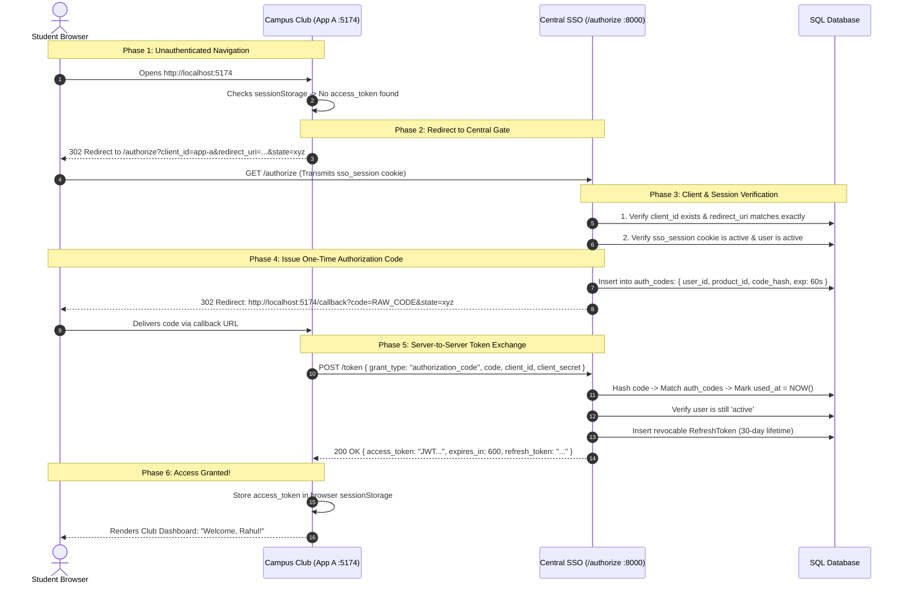
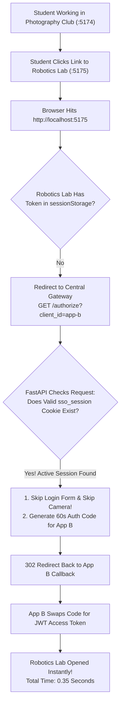

# 02 — SSO Flow (OAuth 2.0 Authorize, Tokens & 1-Click Access)

**Status:** Done · **Owner:** Shaan (Backend Lead) · **Date:** 2026-11-20  
**Primary Source Files:**  
- `backend/app/routes/sso.py`
- `backend/app/deps.py`
- `backend/app/models.py`
- `backend/app/security.py`

---

## 🌟 1. What it is (Plain Words / Layman Explanation)

The **Single Sign-On (SSO) Flow** allows students to unlock every campus club application with a single master key:
1. **The Passport Control Metaphor**:
   - Imagine visiting a campus festival with 5 exhibition halls (Photography, Robotics, AI, Chess, Athletics).
   - In a traditional system, each hall makes you stand in line, show your ID, and fill out a 10-page paper form every single time you enter.
   - With **Sankalp SSO**, you show your ID and complete your camera check once at the **Main Entrance Gate** (`:5173`).
   - The gate officer gives your browser a stamped wristband (an `sso_session` cookie).
2. **The 1-Click Switch**:
   - When you walk over to the Robotics Lab, the lab door sees your wristband and hands you a 10-minute entry ticket (**Access Token**) instantly—**no typing passwords, no turning your head at the camera again!**
3. **The Secret Handshake (Authorization Code)**:
   - For maximum security, the central gate never sends sensitive access keys directly across your browser address bar. Instead, it sends a secret one-time code valid for only 60 seconds. The club application secretly calls the backend server to swap the code for the real access token.

---

## 🎯 2. Why it exists (Requirements Coverage)

This module implements the following core specifications from `docs/specs/srs.md`:
- **M4**: Central Single Sign-On, redirect with a single-use authorization code, independent tokens for each connected product, and 1-click entry into second products.
- **FR4**: 10-minute JWT access tokens and hashed, stateful, revocable refresh tokens.
- **FR6**: Product registration, unique client secrets, and exact `redirect_uri` validation.
- **FR8**: Returning users with live sessions bypass login forms and camera checks.

---

## 🔄 3. How it works (Architectural Workflows & Visual Pipelines)

### 3.1. Complete OAuth 2.0 Authorization Code Exchange Pipeline



---

### 3.2. Seamless One-Click Cross-App Navigation



---

## 💻 4. Key Source Code

### `backend/app/routes/sso.py` (Full Core Implementation)

```python
from datetime import datetime, timedelta
from typing import Optional
from urllib.parse import urlencode
from fastapi import APIRouter, Depends, HTTPException, Request, Response, status
from fastapi.responses import RedirectResponse
from pydantic import BaseModel
from sqlalchemy.orm import Session

from app.database import get_db
from app.models import Product, User, SsoSession, AuthCode, RefreshToken
from app.security import (
    hash_token,
    generate_random_token,
    create_access_token,
    verify_password
)
from app.audit import log_audit
from app.config import FRONTEND_ORIGIN
from app.deps import get_current_session, get_current_user_from_token

router = APIRouter(tags=["sso"])

class TokenRequest(BaseModel):
    grant_type: str = "authorization_code"
    code: str
    client_id: str
    client_secret: str

class RefreshRequest(BaseModel):
    refresh_token: str
    client_id: str
    client_secret: str

def verify_product_secret(product: Product, secret: str) -> bool:
    """Verify application client secret against stored hash."""
    if hash_token(secret) == product.client_secret_hash:
        return True
    return verify_password(secret, product.client_secret_hash)


@router.get("/authorize")
def authorize(
    client_id: str,
    redirect_uri: str,
    state: Optional[str] = None,
    request: Request = None,
    db: Session = Depends(get_db),
    session_obj: Optional[SsoSession] = Depends(get_current_session)
):
    """
    FR6/FR8: OAuth 2.0 Authorization Gateway.
    If active SSO session exists -> issue 60s single-use code and redirect back instantly.
    Else -> redirect to central login portal.
    """
    product = db.query(Product).filter(Product.client_id == client_id).first()
    if not product:
        raise HTTPException(
            status_code=status.HTTP_400_BAD_REQUEST,
            detail={"error": "invalid_client", "message": "Unknown client_id"}
        )

    # Security: Callback URI must match registered whitelist exactly
    if product.redirect_uri.rstrip("/") != redirect_uri.rstrip("/"):
        raise HTTPException(
            status_code=status.HTTP_400_BAD_REQUEST,
            detail={"error": "invalid_redirect_uri", "message": "Redirect URI does not match registered URI"}
        )

    # Check if browser holds a live central SSO session
    if session_obj:
        user = db.query(User).filter(User.id == session_obj.user_id).first()
        if user and user.status == "active":
            # Generate single-use authorization code valid for 60 seconds
            raw_code = generate_random_token(24)
            code_h = hash_token(raw_code)
            auth_code = AuthCode(
                user_id=user.id,
                product_id=product.id,
                code_hash=code_h,
                expires_at=datetime.utcnow() + timedelta(seconds=60),
                used_at=None
            )
            db.add(auth_code)
            user.last_active_at = datetime.utcnow()
            db.commit()

            # Redirect back to club application
            params = {"code": raw_code}
            if state:
                params["state"] = state
            separator = "&" if "?" in redirect_uri else "?"
            target_url = f"{redirect_uri}{separator}{urlencode(params)}"
            return RedirectResponse(url=target_url, status_code=status.HTTP_302_FOUND)

    # No live session -> send user to central login screen
    login_params = {"client_id": client_id, "redirect_uri": redirect_uri}
    if state:
        login_params["state"] = state
    target_url = f"{FRONTEND_ORIGIN}/login?{urlencode(login_params)}"
    return RedirectResponse(url=target_url, status_code=status.HTTP_302_FOUND)


@router.post("/token")
def issue_token(payload: TokenRequest, db: Session = Depends(get_db)):
    """
    FR4: Exchange single-use authorization code for a 10-minute JWT and revocable refresh token.
    """
    product = db.query(Product).filter(Product.client_id == payload.client_id).first()
    if not product or not verify_product_secret(product, payload.client_secret):
        raise HTTPException(
            status_code=status.HTTP_401_UNAUTHORIZED,
            detail={"error": "invalid_client", "message": "Invalid client_id or client_secret"}
        )

    code_h = hash_token(payload.code)
    auth_code = db.query(AuthCode).filter(
        AuthCode.code_hash == code_h,
        AuthCode.product_id == product.id
    ).first()

    if not auth_code or auth_code.used_at is not None or auth_code.expires_at < datetime.utcnow():
        raise HTTPException(
            status_code=status.HTTP_400_BAD_REQUEST,
            detail={"error": "invalid_grant", "message": "Authorization code is invalid, used, or expired"}
        )

    # Mark code spent immediately
    auth_code.used_at = datetime.utcnow()

    user = db.query(User).filter(User.id == auth_code.user_id).first()
    if not user or user.status != "active":
        db.commit()
        raise HTTPException(
            status_code=status.HTTP_403_FORBIDDEN,
            detail={"error": "account_disabled", "message": "User account is not active"}
        )

    access_token = create_access_token(user.id, user.email, user.role)
    raw_refresh = generate_random_token(32)
    refresh_obj = RefreshToken(
        user_id=user.id,
        product_id=product.id,
        token_hash=hash_token(raw_refresh),
        expires_at=datetime.utcnow() + timedelta(days=30),
        revoked_at=None
    )
    db.add(refresh_obj)
    db.commit()

    log_audit(db, action="token_issued", actor_id=user.id, target_id=product.id, detail={"product": product.name})
    return {
        "access_token": access_token,
        "token_type": "bearer",
        "expires_in": 600,
        "refresh_token": raw_refresh
    }


@router.post("/token/refresh")
def refresh_access_token(payload: RefreshRequest, db: Session = Depends(get_db)):
    """Refreshes a 10-minute access token using an active refresh token."""
    product = db.query(Product).filter(Product.client_id == payload.client_id).first()
    if not product or not verify_product_secret(product, payload.client_secret):
        raise HTTPException(status_code=401, detail={"error": "invalid_client", "message": "Invalid credentials"})

    tok_h = hash_token(payload.refresh_token)
    ref_obj = db.query(RefreshToken).filter(
        RefreshToken.token_hash == tok_h,
        RefreshToken.product_id == product.id,
        RefreshToken.revoked_at.is_(None),
        RefreshToken.expires_at > datetime.utcnow()
    ).first()

    if not ref_obj:
        raise HTTPException(status_code=400, detail={"error": "invalid_grant", "message": "Refresh token is invalid or revoked"})

    user = db.query(User).filter(User.id == ref_obj.user_id).first()
    if not user or user.status != "active":
        raise HTTPException(status_code=403, detail={"error": "account_disabled", "message": "Account is disabled"})

    new_access_token = create_access_token(user.id, user.email, user.role)
    return {"access_token": new_access_token, "token_type": "bearer", "expires_in": 600}


@router.get("/userinfo")
def get_user_info(current_user: User = Depends(get_current_user_from_token)):
    """Resolves member identity from Bearer access token."""
    return {
        "id": current_user.id,
        "name": current_user.name,
        "email": current_user.email,
        "role": current_user.role
    }
```

---

## 🔍 5. Code Explanation (Block-by-Block for Freshers)

1. **`authorize(...)` URI Validation**:
   - `product.redirect_uri.rstrip("/") != redirect_uri.rstrip("/")` prevents **Open Redirect Vulnerabilities**. If an attacker tricks a user into clicking a link with `redirect_uri=http://attacker-controlled-site.com`, the server rejects it with HTTP 400.
2. **60-Second Single-Use Authorization Codes**:
   - The code is stored in `auth_codes` with `expires_at = datetime.utcnow() + timedelta(seconds=60)`.
   - When exchanged via `/token`, `auth_code.used_at = datetime.utcnow()` executes within the database transaction. If an attacker intercepts the code from browser history, it is already marked spent and fails.
3. **Dual Token Balance (JWT + State Database)**:
   - `access_token`: A stateless signed JWT that connected club applications verify on every API call. It lives for only 10 minutes.
   - `refresh_token`: Stored in the database and checked against `User.status == "active"`. When an administrator clicks "Mark as left", revoking the refresh token guarantees the user can never refresh their access.
4. **`userinfo(...)` Dependency Injection**:
   - Uses FastAPI's `Depends(get_current_user_from_token)` to extract the Bearer header, verify the HS256 JWT cryptographic signature, and ensure the member has not been disabled.

---

## 🧪 6. How to Run and Test It

### 6.1. Automated Test Suite
```bash
pytest backend/tests/test_sso.py -v
```

### 6.2. Manual Verification Walkthrough
1. Boot all services: `.\start.bat`.
2. Open Photography Club: `http://localhost:5174`.
3. Click **"Sign In with Sankalp SSO"** &rarr; Complete sign-in &rarr; Redirects back to `:5174` with token &rarr; **Welcome!**
4. In a second tab, open Robotics Lab: `http://localhost:5175`.
5. Click **"Sign In with Sankalp SSO"** &rarr; Page flickers for 0.35s and renders **Welcome!** with zero credentials prompted.

**Satisfied Test Checklist Items:**
- [x] App A redirects unauthenticated users to central login.
- [x] Authorization code works once only and expires in 60 seconds.
- [x] Mismatched `redirect_uri` is refused.
- [x] App B opens instantly via live `sso_session` cookie.
- [x] Token refresh succeeds for active accounts and fails for disabled users.

---

## ⚠️ 7. Known Limits & Future Work

1. **Token Storage in Demo Apps**:
   - The lightweight demo clubs store access tokens in browser `sessionStorage` for presentation simplicity. In enterprise multi-subdomain deployments, tokens should be exchanged via server-side session cookies.
2. **Asymmetric Key Signing (RS256 / Ed25519)**:
   - Currently, tokens are signed using HMAC-SHA256 (`HS256`) with a shared secret. Upgrading to RS256 with public JWKS endpoints (`/.well-known/jwks.json`) will allow external products to verify tokens without knowing the master signing secret.
