# 05 — Cleanup Job (Automated Lifecycle Expiry & Inactivity Janitor)

**Status:** Done · **Owner:** Shaan (Backend Lead) · **Date:** 2026-11-20  
**Primary Source Files:**  
- `backend/app/jobs/cleanup.py`
- `backend/app/main.py` (APScheduler Lifespan Integration)
- `backend/app/routes/admin.py` (On-Demand Trigger Endpoint)

---

## 🌟 1. What it is (Plain Words / Layman Explanation)

The **Cleanup Job** is the automated digital janitor of the university campus:
1. **The Graduated Student Problem**:
   - Imagine a university campus where students receive digital RFID cards to enter the photography studio, chemistry labs, and sports gym.
   - When 500 seniors graduate in June, nobody remembers to collect or deactivate their digital cards. In October, former students can still sneak into the labs.
2. **The Automated Nightly Janitor**:
   - Every night at midnight, while everyone is asleep, an automated background program (**APScheduler**) sweeps through the database.
   - **Check 1 (Term Expiration)**: Did this student's membership period end yesterday? If yes, it flips their status to `disabled` and cancels their active passes.
   - **Check 2 (Inactivity)**: Has this user failed to log in for more than 60 days? If yes, it assumes they have left the club and locks their account.
3. **The On-Demand Presentation Button**:
   - For hackathon demonstrations, judges do not want to wait 24 hours until midnight! So we added an on-demand button in the Admin Console: clicking **"Run Cleanup Now"** triggers the janitor instantly in front of the judges.

---

## 🎯 2. Why it exists (Requirements Coverage)

This module implements the following core specifications from `docs/specs/srs.md`:
- **M6**: Automatic cleanup: term end date and inactivity disable accounts.
- **FR2**: Disabling an account revokes the SSO session and all refresh tokens immediately.
- **FR7**: Writing automated administrative actions (`user_disabled_auto`) to the audit log.

---

## 🔄 3. How it works (Architectural Workflows & Visual Pipelines)

### 3.1. Triple-Policy Janitor Pipeline with 48-Hour Recovery & Hard Purge

```mermaid
flowchart TD
    Clock["APScheduler Timer (Every 24 Hours)<br/>OR Admin Clicks 'Run Cleanup Now'"] --> Start["run_cleanup_job(db) Initiated"]
    
    subgraph Policy1 ["Policy 1: Term End Date Check"]
        Start --> QueryTerm["SQL Query: Find Users where<br/>status == 'active' AND term_end < TODAY()"]
        QueryTerm --> ForEachTerm{"Any Expired Students Found?"}
        ForEachTerm -->|Yes| DisableTerm["1. Set user.status = 'disabled'<br/>2. Set user.disabled_reason = 'term_end'<br/>3. Revoke all SsoSession & RefreshToken rows<br/>4. Write 'user_disabled_auto' to audit_log<br/>5. Send 48h Recovery Email with /renew link"]
        ForEachTerm -->|No| NextPolicy["Proceed to Inactivity Policy"]
        DisableTerm --> NextPolicy
    end

    subgraph Policy2 ["Policy 2: 60-Day Inactivity Check"]
        NextPolicy --> QueryInactive["SQL Query: Find Users where<br/>status == 'active' AND last_active_at < (NOW - 60 Days)"]
        ForEachInactive{"Any Inactive Accounts Found?"}
        QueryInactive --> ForEachInactive
        ForEachInactive -->|Yes| DisableInactive["1. Set user.status = 'disabled'<br/>2. Set user.disabled_reason = 'inactive'<br/>3. Revoke all SsoSession & RefreshToken rows<br/>4. Write 'user_disabled_auto' to audit_log<br/>5. Send 48h Recovery Email with /renew link"]
        ForEachInactive -->|No| Policy3["Proceed to 48-Hour Hard Purge"]
        DisableInactive --> Policy3
    end

    subgraph Policy3Section ["Policy 3: 48-Hour Hard Purge & Takeout Export"]
        Policy3 --> QueryPurge["SQL Query: Find Users where<br/>status == 'disabled' AND disabled_at <= NOW - 48 Hours"]
        QueryPurge --> ForEachPurge{"Elapsed 48h Without Approved Renewal?"}
        ForEachPurge -->|Yes| PurgeExec["1. Extract user profile data dictionary<br/>2. Send Data Takeout & Re-registration Email<br/>3. Erase biometric embeddings & document files from disk<br/>4. Write 'user_purged_permanently' to audit_log<br/>5. Hard delete user row from database (zero vault retention)"]
        ForEachPurge -->|No| CommitCleanup["Commit Database Transaction"]
        PurgeExec --> CommitCleanup
    end

    CommitCleanup --> Done["Return Summary Report JSON:<br/>{ total_disabled: N, total_purged: M, purged_users: [...] }"]
```



---

## 💻 4. Key Source Code

### 4.1. Core Cleanup Logic (`backend/app/jobs/cleanup.py`)

```python
import os
from datetime import datetime, date, timedelta
from typing import Dict, Any
from sqlalchemy.orm import Session

from app.models import User, SsoSession, RefreshToken, RenewalRequest
from app.audit import log_audit
from app.config import INACTIVITY_DAYS, PURGE_GRACE_HOURS, FRONTEND_ORIGIN
from app.services.email_service import send_expired_email, send_final_purge_takeout_email

def run_cleanup_job(db: Session) -> Dict[str, Any]:
    """
    M6/FR2/FR3: Runs automatic cleanup, 48-hour recovery enforcement, and permanent purge.
    1. Disables accounts where:
       a. term_end is in the past (term_end < today)
       b. inactive for over INACTIVITY_DAYS (default 60 days)
       Immediately revokes all active SSO sessions and refresh tokens,
       logs 'user_disabled_auto', and sends 48-hour recovery/renewal email.
    2. 48-Hour Hard Purge:
       Target all disabled users whose 48-hour window has expired and have no approved renewal.
       Dispatches complete personal data takeout export email to user.
       Permanently purges user row and uploaded identity files from disk.
    """
    now = datetime.utcnow()
    today = date.today()
    inactivity_threshold = now - timedelta(days=INACTIVITY_DAYS)
    purge_threshold = now - timedelta(hours=PURGE_GRACE_HOURS)

    disabled_users = []
    purged_users = []

    # 1. Term End Policy
    expired_term_users = db.query(User).filter(
        User.status == "active",
        User.term_end.is_not(None),
        User.term_end < today
    ).all()

    for user in expired_term_users:
        user.status = "disabled"
        user.disabled_reason = "term_end"
        user.disabled_at = now

        db.query(SsoSession).filter(
            SsoSession.user_id == user.id,
            SsoSession.revoked_at.is_(None)
        ).update({"revoked_at": now})

        db.query(RefreshToken).filter(
            RefreshToken.user_id == user.id,
            RefreshToken.revoked_at.is_(None)
        ).update({"revoked_at": now})

        log_audit(
            db,
            action="user_disabled_auto",
            actor_id="system_cleanup_job",
            target_id=user.id,
            detail={"reason": "term_end", "term_end": str(user.term_end)}
        )

        renew_url = f"{FRONTEND_ORIGIN}/renew?email={user.email}"
        try:
            send_expired_email(user.email, user.name, renew_url, reason="term_end")
        except Exception:
            pass

        disabled_users.append({"id": user.id, "email": user.email, "reason": "term_end"})

    # 2. Inactivity Policy
    inactive_users = db.query(User).filter(
        User.status == "active",
        User.created_at < inactivity_threshold,
        (User.last_active_at < inactivity_threshold) | (User.last_active_at.is_(None))
    ).all()

    for user in inactive_users:
        user.status = "disabled"
        user.disabled_reason = "inactive"
        user.disabled_at = now

        db.query(SsoSession).filter(
            SsoSession.user_id == user.id,
            SsoSession.revoked_at.is_(None)
        ).update({"revoked_at": now})

        db.query(RefreshToken).filter(
            RefreshToken.user_id == user.id,
            RefreshToken.revoked_at.is_(None)
        ).update({"revoked_at": now})

        log_audit(
            db,
            action="user_disabled_auto",
            actor_id="system_cleanup_job",
            target_id=user.id,
            detail={"reason": "inactive", "days_threshold": INACTIVITY_DAYS}
        )

        renew_url = f"{FRONTEND_ORIGIN}/renew?email={user.email}"
        try:
            send_expired_email(user.email, user.name, renew_url, reason="inactive")
        except Exception:
            pass

        disabled_users.append({"id": user.id, "email": user.email, "reason": "inactive"})

    db.commit()

    # 3. 48-Hour Hard Purge (Permanent Erasure & Data Takeout Dispatch)
    eligible_for_purge = db.query(User).filter(
        User.status == "disabled",
        User.disabled_at.is_not(None),
        User.disabled_at <= purge_threshold
    ).all()

    for u in eligible_for_purge:
        has_approved = db.query(RenewalRequest).filter(
            RenewalRequest.user_id == u.id,
            RenewalRequest.status == "approved"
        ).first()

        if has_approved:
            continue

        user_email = u.email
        user_name = u.name
        user_id = u.id
        reason = u.disabled_reason or "disabled"

        user_data = {
            "name": user_name,
            "email": user_email,
            "phone": u.phone,
            "created_at": u.created_at,
            "disabled_at": u.disabled_at,
            "disabled_reason": reason,
        }

        try:
            send_final_purge_takeout_email(user_email, user_data, background=False)
        except Exception:
            pass

        if u.face_photo_path and os.path.exists(u.face_photo_path):
            try:
                os.remove(u.face_photo_path)
            except Exception:
                pass

        if u.document_path and os.path.exists(u.document_path):
            try:
                os.remove(u.document_path)
            except Exception:
                pass

        log_audit(
            db,
            action="user_purged_permanently",
            actor_id="system_cleanup_job",
            target_id=user_id,
            detail={"email": user_email, "name": user_name, "reason": reason, "held_hours": PURGE_GRACE_HOURS}
        )

        db.delete(u)
        purged_users.append({"id": user_id, "email": user_email, "reason": reason})

    db.commit()

    return {
        "status": "ok",
        "processed_at": now.isoformat(),
        "total_disabled": len(disabled_users),
        "disabled_users": disabled_users,
        "total_purged": len(purged_users),
        "purged_users": purged_users
    }
```
        user.disabled_reason = "term_end"
        user.disabled_at = now

        # Revoke SSO sessions
        db.query(SsoSession).filter(
            SsoSession.user_id == user.id,
            SsoSession.revoked_at.is_(None)
        ).update({"revoked_at": now})

        # Revoke refresh tokens
        db.query(RefreshToken).filter(
            RefreshToken.user_id == user.id,
            RefreshToken.revoked_at.is_(None)
        ).update({"revoked_at": now})

        log_audit(
            db,
            action="user_disabled_auto",
            actor_id="system_cleanup_job",
            target_id=user.id,
            detail={"reason": "term_end", "term_end": str(user.term_end)}
        )
        disabled_users.append({"id": user.id, "email": user.email, "reason": "term_end"})

    # 2. Inactivity Policy: Find abandoned accounts
    inactive_users = db.query(User).filter(
        User.status == "active",
        User.created_at < inactivity_threshold,
        (User.last_active_at < inactivity_threshold) | (User.last_active_at.is_(None))
    ).all()

    for user in inactive_users:
        user.status = "disabled"
        user.disabled_reason = "inactive"
        user.disabled_at = now

        # Revoke SSO sessions
        db.query(SsoSession).filter(
            SsoSession.user_id == user.id,
            SsoSession.revoked_at.is_(None)
        ).update({"revoked_at": now})

        # Revoke refresh tokens
        db.query(RefreshToken).filter(
            RefreshToken.user_id == user.id,
            RefreshToken.revoked_at.is_(None)
        ).update({"revoked_at": now})

        log_audit(
            db,
            action="user_disabled_auto",
            actor_id="system_cleanup_job",
            target_id=user.id,
            detail={"reason": "inactive", "days_threshold": INACTIVITY_DAYS}
        )
        disabled_users.append({"id": user.id, "email": user.email, "reason": "inactive"})

    db.commit()
    return {
        "status": "ok",
        "processed_at": now.isoformat(),
        "total_disabled": len(disabled_users),
        "disabled_users": disabled_users
    }
```

---

### 4.2. FastAPI Lifespan Scheduler Daemon (`backend/app/main.py`)

```python
from apscheduler.schedulers.background import BackgroundScheduler
from app.jobs.cleanup import run_cleanup_job

scheduler = BackgroundScheduler()

def scheduled_cleanup():
    """Wrapper function invoked every 24 hours by APScheduler thread pool."""
    logger.info("Executing daily automated cleanup job...")
    db = SessionLocal()
    try:
        res = run_cleanup_job(db)
        logger.info("Scheduled cleanup complete: %s", res)
    except Exception as e:
        logger.error("Error running cleanup job: %s", e)
    finally:
        db.close()

@asynccontextmanager
async def lifespan(app: FastAPI):
    # Register daily 24-hour cleanup job on server startup
    enable_scheduler = os.getenv("ENABLE_SCHEDULER", "true").lower() == "true"
    if enable_scheduler and not scheduler.running:
        try:
            scheduler.add_job(
                scheduled_cleanup,
                "interval",
                hours=24,
                id="daily_cleanup",
                replace_existing=True
            )
            scheduler.start()
            logger.info("APScheduler background cleanup daemon registered.")
        except Exception as e:
            logger.warning(f"Could not start scheduler: {e}")

    yield

    # Clean shutdown of scheduler thread
    if scheduler.running:
        scheduler.shutdown(wait=False)
```

---

## 🔍 5. Code Explanation (Block-by-Block for Freshers)

1. **Calendar Date vs. Timestamp Matching**:
   - `today = date.today()` retrieves the current calendar date without time components.
   - `User.term_end < today` evaluates whether the student's term ended yesterday or earlier. This guarantees that student memberships remain valid until 11:59:59 PM on their graduation day and expire precisely at midnight.
2. **Dynamic Inactivity Calculation**:
   - `inactivity_threshold = now - timedelta(days=INACTIVITY_DAYS)` calculates the cutoff timestamp based on the configuration variable (default: 60 days).
   - The query verifies that `User.created_at < inactivity_threshold` so that brand new students registered 5 minutes ago are not mistakenly flagged as inactive before their first session!
3. **Atomic Session & Refresh Token Revocation**:
   - Just like an administrator clicking "Mark as left", the automated cleanup updates `SsoSession.revoked_at` and `RefreshToken.revoked_at` in the same transaction. The expired student cannot continue opening connected campus clubs.
4. **`actor_id="system_cleanup_job"` Audit Accountability**:
   - In the audit ledger, automated entries explicitly indicate that the system janitor changed the user's permissions, distinguishing automated maintenance from human administrative actions.

---

## 🧪 6. How to Run and Test It

### 6.1. Automated Test Suite
```bash
pytest backend/tests/test_admin_and_cleanup.py -k test_admin_and_cleanup_flow -v
```

### 6.2. On-Demand Presentation Testing
1. In the database seed, there is an expired alumni account (`alumni_expired@ju.edu`) whose `term_end` is set to 10 days in the past.
2. Open Admin Console: `http://localhost:5173/admin`.
3. Locate the **Automated Janitor** control card and click **"Run Cleanup Now"**.
4. An alert confirms: *"Cleanup Job Executed: 1 user disabled (alumni_expired@ju.edu — reason: term_end)"*.
5. Inspect the Audit Log below to see the newly appended `user_disabled_auto` event.

**Satisfied Test Checklist Items:**
- [x] Past term end dates are automatically disabled by the cleanup job.
- [x] Inactivity exceeding 60 days automatically disables the account.
- [x] Automated cleanups immediately revoke active sessions and refresh tokens.
- [x] Automated cleanups write `user_disabled_auto` to the audit log.

---

## ⚠️ 7. Known Limits & Future Work

1. **Advance Expiration Warning Emails**:
   - Currently, the janitor disables accounts immediately upon term expiration. Integrating an optional email hook (e.g. sending a friendly warning email 7 days before term end) is planned as an upcoming usability feature.
