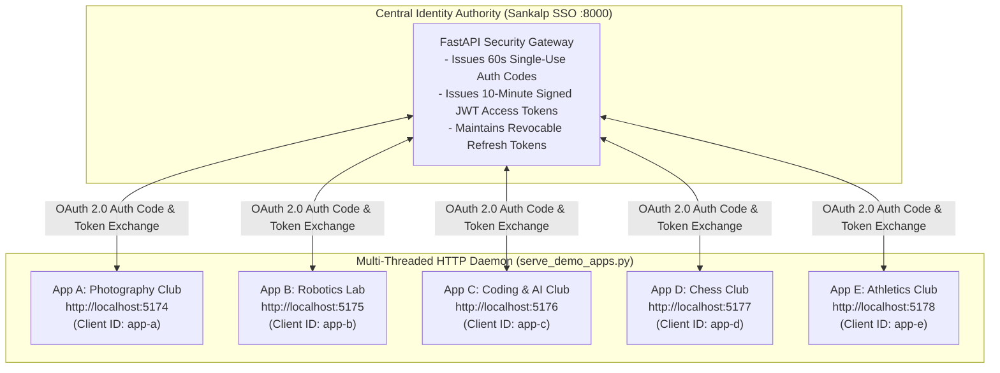
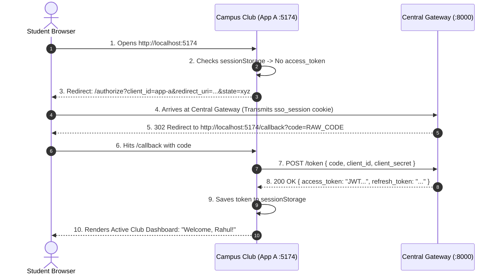

# 07 — Connected Campus Clubs (5 Demo Apps: App A through App E)

**Status:** Done · **Owner:** Shaan & Arka · **Date:** 2026-11-20  
**Primary Source Files:**  
- `demo-apps/serve_demo_apps.py` (Multi-Port Multi-Threaded HTTP Server)
- `demo-apps/app-a/index.html` (Photography Club — Port 5174)
- `demo-apps/app-b/index.html` (Robotics Lab — Port 5175)
- `demo-apps/app-c/index.html` (Coding & AI Club — Port 5176)
- `demo-apps/app-d/index.html` (Chess & Mind Sports — Port 5177)
- `demo-apps/app-e/index.html` (Athletics & Sports — Port 5178)

---

## 🌟 1. What it is (Plain Words / Layman Explanation)

Imagine a modern university campus with 5 completely separate student clubs and lab facilities:
1. **Photography Club (Port 5174)**: Checkout expensive DSLR cameras, lenses, and darkrooms.
2. **Robotics Lab (Port 5175)**: Operate 3D printers, laser cutters, and laboratory smart door locks.
3. **Coding & AI Club (Port 5176)**: Allocate GPU cluster access and collaborate on hackathon repositories.
4. **Chess & Mind Sports (Port 5177)**: Register for tournament brackets and manage player ELO ratings.
5. **Athletics & Sports (Port 5178)**: Schedule gym sessions and checkout athletic equipment.

### The Nightmare of Old Systems vs. Sankalp SSO
- **The Nightmare**: Without SSO, a student has 5 different usernames, 5 different passwords, and logs in 5 times every day. When that student graduates, the college admin has to remember to log into all 5 club databases to delete them. If the admin forgets even one, the student retains unauthorized access!
- **With Sankalp SSO**:
  - The student signs in **once** at the central gate (`:5173`) with their password and a quick 10-second camera check.
  - From their campus dashboard, they can click into **any of the 5 clubs with 1 single click**—no typing passwords again, no repeating the camera check!
  - When the administrator clicks **"Mark as left"**, access across **all 5 clubs terminates in under 0.2 seconds simultaneously**.

---

## 🎯 2. Why it exists (Requirements Coverage)

This module implements the following core specifications from `docs/specs/srs.md`:
- **M8**: Connected demo apps demonstrating both Welcome (active) and instant Access Denied (revoked) states.
- **M4**: Central Single Sign-On (SSO) with seamless 1-click transitions between independent applications.
- **FR6**: External product registration with client IDs, hashed secrets, and strict callback URI matching.
- **FR2**: Instant cross-application revocation of sessions and refresh tokens.

---

## 🔄 3. How it works (Architectural Workflows & Visual Pipelines)

### 3.1. Five Connected Campus Clubs Topology



---

### 3.2. Step-by-Step OAuth Interaction Flow



---

## 💻 4. Key Source Code

### 4.1. Multi-Port Multi-Threaded HTTP Server (`demo-apps/serve_demo_apps.py`)

```python
import http.server
import socketserver
import threading
from pathlib import Path

base_dir = Path(__file__).resolve().parent

class CustomHandler(http.server.SimpleHTTPRequestHandler):
    """
    Custom HTTP request handler providing CORS headers and Single-Page
    Application (SPA) client-side routing for /callback URLs.
    """
    def end_headers(self):
        self.send_header('Access-Control-Allow-Origin', '*')
        self.send_header('Access-Control-Allow-Methods', 'GET, POST, OPTIONS')
        self.send_header('Access-Control-Allow-Headers', '*')
        super().end_headers()

    def do_GET(self):
        # Single-Page Application routing: serve index.html for / and /callback
        if self.path == "/" or self.path.startswith("/callback"):
            self.path = "/index.html"
        return super().do_GET()


def run_server(port: int, folder: Path, club_name: str):
    """Binds an independent TCPServer on a dedicated thread for each club."""
    class Handler(CustomHandler):
        def __init__(self, *args, **kwargs):
            super().__init__(*args, directory=str(folder), **kwargs)

    socketserver.TCPServer.allow_reuse_address = True
    with socketserver.TCPServer(("", port), Handler) as httpd:
        print(f"   🚀 [{club_name}] active on http://localhost:{port}")
        httpd.serve_forever()


if __name__ == "__main__":
    clubs = [
        {"port": 5174, "dir": base_dir / "app-a", "name": "Photography Club"},
        {"port": 5175, "dir": base_dir / "app-b", "name": "Robotics Lab"},
        {"port": 5176, "dir": base_dir / "app-c", "name": "Coding & AI Club"},
        {"port": 5177, "dir": base_dir / "app-d", "name": "Chess & Mind Sports"},
        {"port": 5178, "dir": base_dir / "app-e", "name": "Athletics & Sports"}
    ]
    print("\n🏛️  Starting 5 Connected Campus Club Servers...")
    for c in clubs:
        threading.Thread(target=run_server, args=(c["port"], c["dir"], c["name"]), daemon=True).start()

    print("   All 5 clubs active. Press Ctrl+C to terminate.\n")
    threading.Event().wait()
```

---

### 4.2. Client-Side OAuth 2.0 Handler (`demo-apps/app-a/index.html` - Script Extract)

```javascript
const CLIENT_ID = "app-a";
const CLIENT_SECRET = "secret-app-a-key-2026";
const AUTH_SERVER = "http://localhost:8000";
const REDIRECT_URI = "http://localhost:5174/callback";

function initiateLogin() {
  const state = "state_photo_" + Math.random().toString(36).substring(7);
  sessionStorage.setItem("oauth_state", state);
  window.location.href = `${AUTH_SERVER}/authorize?client_id=${CLIENT_ID}&redirect_uri=${encodeURIComponent(REDIRECT_URI)}&state=${state}`;
}

async function handleCallback() {
  const urlParams = new URLSearchParams(window.location.search);
  const code = urlParams.get("code");
  if (!code) return false;

  // Clean the URL bar so the code is not visible in browser history
  window.history.replaceState({}, document.title, window.location.pathname);

  // Exchange code for 10-minute JWT access token
  const response = await fetch(`${AUTH_SERVER}/token`, {
    method: "POST",
    headers: { "Content-Type": "application/json" },
    body: JSON.stringify({
      grant_type: "authorization_code",
      code: code,
      client_id: CLIENT_ID,
      client_secret: CLIENT_SECRET
    })
  });

  const data = await response.json();
  if (response.ok && data.access_token) {
    sessionStorage.setItem("access_token", data.access_token);
    sessionStorage.setItem("refresh_token", data.refresh_token);
    loadUserProfile();
  } else {
    renderAccessDenied(data.message || "Authentication grant failed.");
  }
}
```

---

## 🔍 5. Code Explanation (Block-by-Block for Freshers)

1. **`socketserver.TCPServer.allow_reuse_address = True`**:
   - On Windows and Linux, shutting down a local HTTP server normally leaves the port in a `TIME_WAIT` socket state for up to 60 seconds. Enabling `allow_reuse_address` allows restarting the test script instantly without encountering `Address already in use` errors.
2. **SPA Routing in `CustomHandler`**:
   - When the central gateway redirects to `http://localhost:5174/callback?code=XYZ`, a default static file server would look on the hard drive for a file named `callback` and return a 404 error!
   - The custom handler intercepts any path starting with `/callback` and serves `index.html`, allowing client-side JavaScript to read the `?code=` query parameter seamlessly.
3. **`window.history.replaceState(...)`**:
   - Once JavaScript extracts the authorization code, it wipes the query string from the browser address bar. This ensures that if the user bookmarks the page or clicks Back, the spent authorization code is not re-submitted.
4. **Instant Invalidation Handling**:
   - The club application polls `GET /userinfo` or calls `POST /token/refresh`. If the user has been marked as left, the server returns HTTP 403 `account_disabled`. The client immediately removes the token from storage and paints the screen with the red **ACCESS DENIED** card.

---

## 🧪 6. How to Run and Test It

### 6.1. Start All 5 Clubs
```powershell
python demo-apps/serve_demo_apps.py
```

### 6.2. Verify 1-Click SSO Navigation
1. Open **Photography Club**: `http://localhost:5174`.
2. Click **"Sign in with Real Access"** &rarr; Sign in & pass camera check &rarr; **Welcome to Photography Club!**
3. In separate browser tabs, open:
   - **Robotics Lab**: `http://localhost:5175`
   - **Coding & AI Club**: `http://localhost:5176`
   - **Chess & Mind Sports**: `http://localhost:5177`
   - **Athletics & Sports**: `http://localhost:5178`
4. Click Sign In on all of them: **all 4 open instantly with 1 single click!**

### 6.3. Verify Instant Revocation (< 0.2s)
1. Open Admin Console (`:5173/admin`). Click **"Mark as left"** on Rahul.
2. Refresh all 5 club tabs.
3. Every single club immediately displays **ACCESS DENIED** in red.

**Satisfied Test Checklist Items:**
- [x] App A through App E connected via registered OAuth client credentials.
- [x] One login unlocks all 5 connected campus facilities.
- [x] Returning user transitions across clubs with 0 repeated camera prompts.
- [x] Mark as left terminates access across all 5 facilities simultaneously (< 0.2s).

---

## ⚠️ 7. Known Limits & Future Work

1. **Localhost Ports Simulation**:
   - In a production university environment, each club would reside on its own institutional subdomain (e.g., `photo.jadavpur.edu`, `robotics.jadavpur.edu`). In this standalone offline hackathon package, distinct ports (`5174`–`5178`) simulate distinct origins.
