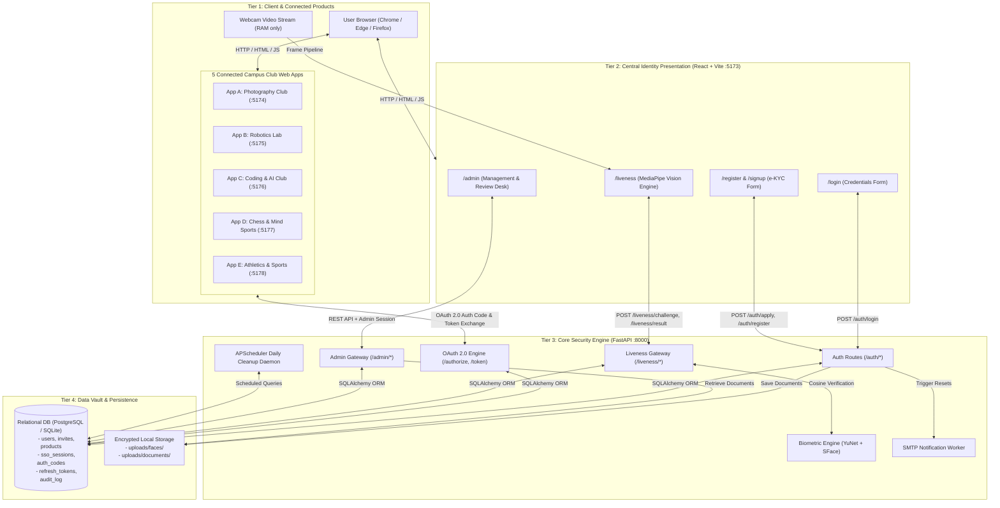
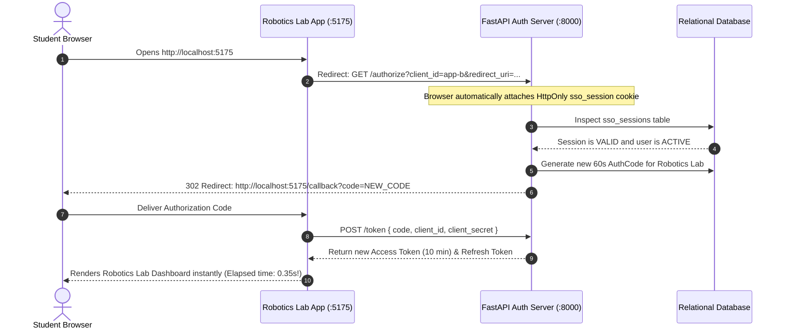
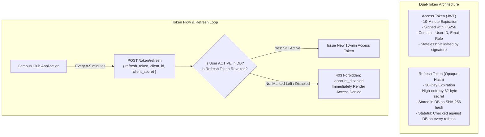

# architecture.md — Technical Architecture & System Blueprint

**Project:** Real Person, Real Access · **Product:** Sankalp SSO  
**Team:** Sankalp (Shreyans Dey, Arka Paul) · **Event:** Hack N Pitch 2026, Jadavpur University E-Cell  

---

## 1. System Topology & Architectural Overview

Sankalp SSO is built on a clean **four-tier decoupled architecture**:
1. **The Client Tier (Browser & Connected Club Applications)**:
   - Modern web browsers running client-side React single-page applications (SPAs).
   - Local webcam hardware driving WebGL/WASM computer vision.
   - 5 independent campus club web applications simulating decentralized university facilities.
2. **The Presentation & Identity Gate Tier (React + Vite :5173)**:
   - Hosts user authentication interfaces: Login, e-KYC Onboarding, Forgot/Reset Password, and the 3-step Liveness Verification camera experience.
   - Hosts the Administrator Console for membership lifecycle and e-KYC reviews.
3. **The Application & Security Core Tier (Python FastAPI :8000)**:
   - Asynchronous HTTP/REST application server.
   - Handles password hashing (Argon2), token signing (PyJWT HS256), cryptographic one-time code generation, and audit logging.
   - Incorporates OpenCV YuNet and SFace deep neural network engines for 1:1 facial embedding extraction and cosine similarity verification.
   - Hosts APScheduler background daemon for automated account cleanup.
4. **The Persistence & Data Vault Tier**:
   - Relational database (SQLite for zero-friction local development, PostgreSQL for enterprise deployments).
   - Local secure storage vault (`uploads/faces/` and `uploads/documents/`) for administrative verification proofs.



---

## 2. The OAuth 2.0 Authorization Code Flow

Sankalp SSO adheres to the industry-standard **OAuth 2.0 Authorization Code Grant** specification. This architecture guarantees that connected applications (clubs) never see or handle student passwords, camera streams, or biometric templates.

```mermaid
sequenceDiagram
    autonumber
    actor User as Student Browser
    participant Club as Campus Club App (e.g. Photography :5174)
    participant CentralUI as Central Login UI (:5173)
    participant Backend as FastAPI Auth Server (:8000)
    participant DB as Relational Database

    Note over User, Club: 1. Student opens Campus Club App
    User->>Club: Opens http://localhost:5174
    Club->>Club: Checks local sessionStorage for Access Token
    Note over Club: No token found! Must authenticate.
    
    Note over Club, CentralUI: 2. Redirect to Central Authorization Gate
    Club->>CentralUI: Redirect: /authorize?client_id=app-a&redirect_uri=...&state=xyz
    CentralUI->>Backend: Forward Authorization Request
    Backend->>DB: Query SsoSession for active session cookie
    
    alt Case A: No Active Central Session (First Sign-In)
        Backend-->>CentralUI: No session found -> Display Login Page
        User->>CentralUI: Enters Email & Password
        CentralUI->>Backend: POST /auth/login
        Backend->>DB: Validate Argon2 password_hash
        Backend-->>CentralUI: Credentials valid! Next: "liveness"
        
        Note over CentralUI, Backend: 3. Liveness & Biometric Verification
        CentralUI->>Backend: POST /liveness/challenge
        Backend-->>CentralUI: Return { challenge_id, type: "turn_left", code: "748291", expires_in: 30 }
        User->>CentralUI: Completes Head Turn + 2 Natural Blinks
        CentralUI->>Backend: POST /liveness/result (with code + live snapshot frame)
        Backend->>Backend: Verify 30s code hash + SFace Cosine Similarity (>= 0.40)
        Backend->>DB: Mark challenge used + Set liveness_passed_at
        Backend-->>CentralUI: Set-Cookie: sso_session=<id>; HttpOnly; SameSite=Lax
    end

    Note over Backend, Club: 4. One-Time Authorization Code Generation
    Backend->>DB: Generate 24-character AuthCode (valid for 60 seconds)
    Backend-->>User: 302 Redirect to Club callback URL: http://localhost:5174/callback?code=RAW_CODE&state=xyz
    User->>Club: Hits callback URL with code in query string

    Note over Club, Backend: 5. Backend-to-Backend Token Exchange
    Club->>Backend: POST /token { grant_type: "authorization_code", code, client_id, client_secret }
    Backend->>DB: Validate client_secret & one-time code (mark code as spent)
    Backend->>DB: Verify user is currently "active"
    Backend->>DB: Generate revocable RefreshToken (30-day lifetime)
    Backend-->>Club: Return { access_token: "JWT...", expires_in: 600, refresh_token: "..." }
    
    Note over Club, User: 6. Access Granted!
    Club->>Club: Store access_token in sessionStorage
    Club-->>User: Renders Club Dashboard: "Welcome to Photography Club!"
```

---

## 3. The One-Click Single Sign-On (SSO) Switch

Once a student has signed in and verified liveness once, their browser possesses a secure, encrypted `sso_session` cookie issued by the central authority. Navigating to any other club requires **zero passwords and zero camera checks**:



---

## 4. Token Architecture & Refresh Lifecycle

Sankalp SSO utilizes a dual-token strategy to balance performance, security, and instant revocation capability.



---

## 5. Security Boundaries & Zero-Trust Isolation Zones

To protect user privacy and institutional data, the system strictly isolates data into four distinct security zones:

```mermaid
flowchart LR
    subgraph ZoneA ["Zone A: Client RAM (Untrusted / Ephemeral)"]
        Stream["Webcam Stream (640x480 @ 30fps)"]
        Landmarks["MediaPipe 468 3D Landmarks"]
        ZCalc["Dynamic EAR & 3D Depth Math"]
    end

    subgraph ZoneB ["Zone B: Encrypted Transport (TLS / Localhost)"]
        HTTPS["JSON REST Payloads & Base64 Snapshot Frames"]
        Cookies["HttpOnly, SameSite=Lax Session Cookies"]
    end

    subgraph ZoneC ["Zone C: Application Backend (Trusted Compute)"]
        FastAPI["FastAPI Python Core"]
        YuNet["OpenCV YuNet Face Detector"]
        SFace["SFace 128D Deep Feature Network"]
    end

    subgraph ZoneD ["Zone D: Secure Storage (Persistence Vault)"]
        DB_Store[("SQL Database<br/>- Argon2 Hashes<br/>- SHA-256 Token Hashes<br/>- 128D Math Vectors")]
        Doc_Store["Filesystem Vault<br/>- uploads/faces/<br/>- uploads/documents/"]
    end

    ZoneA -->|Only Pass/Fail & Single Still Frame Snapshot| ZoneB
    ZoneB --> ZoneC
    ZoneC -->|Store Hashes & Math Embeddings| ZoneD
```



### 5.1. Zone A: Client Browser Memory
- **Isolation Guarantee**: Continuous video frames from the user's webcam are processed exclusively within the browser's local memory using WebAssembly.
- Video streams are never sent across the network.
- The browser calculates head yaw angles, depth variance, and eye blinks locally. Only a single still photographic frame is extracted when the physical challenge completes.

### 5.2. Zone B: Transport Layer
- On production networks, all communication is forced over HTTPS with TLS 1.3 encryption.
- Cookies are protected with `HttpOnly` (preventing JavaScript extraction), `SameSite=Lax` (preventing Cross-Site Request Forgery / CSRF), and `Secure` flags.

### 5.3. Zone C: Application Server
- Stateless compute tier running FastAPI.
- Executes OpenCV YuNet and SFace models on local CPU in under 30 milliseconds.
- Converts raw camera snapshots into 128-dimensional floating point numerical vectors and immediately discards the temporary frame buffers from memory.

### 5.4. Zone D: Persistence Vault
- Relational database stores **zero plain-text secrets**:
  - Passwords are stored as Argon2id hashes with memory cost 64MB and 2 time iterations.
  - Refresh tokens, authorization codes, and client secrets are stored as SHA-256 digests.
  - Facial identities are stored as 128-dimensional numerical vectors (`[0.0821, -0.1492, ... 128 floats]`). It is impossible to reconstruct a human face from these numbers.

---

## 6. Directory Structure & Code Organization

```
Sankalp_prep_pack/
├── backend/
│   ├── app/
│   │   ├── jobs/
│   │   │   └── cleanup.py          # Daily APScheduler account expiration janitor
│   │   ├── routes/
│   │   │   ├── admin.py            # Member management, e-KYC review, mark-as-left
│   │   │   ├── auth.py             # Signup, apply, register, login, password reset
│   │   │   ├── liveness.py         # 30s challenge codes & biometric verification
│   │   │   └── sso.py              # OAuth 2.0 /authorize and /token endpoints
│   │   ├── services/
│   │   │   ├── email_service.py    # SMTP password reset email dispatcher
│   │   │   └── face_engine.py      # OpenCV YuNet + SFace 128D biometric vector engine
│   │   ├── audit.py                # Tamper-evident security audit logger
│   │   ├── config.py               # Environment variables and system thresholds
│   │   ├── database.py             # SQLAlchemy database engine and session maker
│   │   ├── deps.py                 # FastAPI dependency injection (session & admin checks)
│   │   ├── main.py                 # FastAPI app entry point, CORS, startup hooks
│   │   ├── models.py               # SQLAlchemy ORM database table schemas
│   │   └── security.py             # Argon2 hashing, PyJWT signing, token generators
│   ├── models/                     # Deep learning ONNX model weights
│   │   ├── face_detection_yunet_2023mar.onnx
│   │   └── face_recognition_sface_2021dec.onnx
│   ├── tests/                      # Automated unit and integration test suite
│   ├── uploads/                    # Local storage for e-KYC enrollment documents
│   └── requirements.txt            # Python dependencies
├── frontend/
│   ├── src/
│   │   ├── components/
│   │   │   └── admin/
│   │   │       ├── AdminApplicationsTab.jsx # e-KYC review desk
│   │   │       ├── AdminAuditTab.jsx        # Real-time tamper-resistant audit viewer
│   │   │       ├── AdminFaceLockTab.jsx     # Biometric face lock & multi-admin profiles
│   │   │       ├── AdminInvitesTab.jsx      # Member invitation desk & email dispatches
│   │   │       ├── AdminMembersTab.jsx      # Member directory & instant Mark as Left
│   │   │       └── AdminRenewalsTab.jsx     # 48-hour recovery desk & countdown timer
│   │   ├── pages/
│   │   │   ├── Admin.jsx           # Tabbed management cockpit
│   │   │   ├── AdminLogin.jsx      # Dedicated administrator login screen
│   │   │   ├── Clubs.jsx           # Campus Clubs launcher hub
│   │   │   ├── ForgotPassword.jsx  # Self-service password recovery request
│   │   │   ├── Liveness.jsx        # MediaPipe Face Mesh 3-step liveness camera
│   │   │   ├── Login.jsx           # Central student sign-in portal
│   │   │   ├── Register.jsx        # 3-step e-KYC onboarding registration form
│   │   │   ├── Renew.jsx           # 48-hour self-service member renewal appeals
│   │   │   ├── ResetPassword.jsx   # Token verification and password update
│   │   │   └── Signout.jsx         # Central logout and session termination
│   │   ├── utils/
│   │   │   └── time.js             # Universal Indian Standard Time (IST) formatting
│   │   ├── api.js                  # Centralized Axios HTTP client
│   │   ├── App.jsx                 # React Router URL navigation
│   │   └── main.jsx                # React DOM mount point
├── demo-apps/                      # 5 connected campus clubs
│   ├── app-a/                      # Photography Club (Port 5174)
│   ├── app-b/                      # Robotics Lab (Port 5175)
│   ├── app-c/                      # Coding & AI Club (Port 5176)
│   ├── app-d/                      # Chess & Mind Sports (Port 5177)
│   ├── app-e/                      # Athletics & Sports (Port 5178)
│   └── serve_demo_apps.py          # Multi-port multi-threaded HTTP server
└── docs/                           # Comprehensive documentation hub
    ├── specs/                      # System specifications, data models, APIs
    └── modules/                    # In-depth module-by-module technical manuals
```
