# build-plan.md — Project Implementation Roadmap

**Project:** Real Person, Real Access · **Product:** Sankalp SSO  
**Team:** Sankalp (Shreyans Dey, Arka Paul) · **Event:** Hack N Pitch 2026, Jadavpur University E-Cell  
**Total Development Window:** ~20 Hours  

---

## 👥 Team Work Allocation & Responsibilities

- **Shreyans Dey (Shaan)**: Backend Architecture & Security Core
  - FastAPI application structure, routing, and dependency injection.
  - SQLite/PostgreSQL schemas with SQLAlchemy ORM.
  - Cryptography: Argon2id password hashing, SHA-256 digests, and PyJWT token generation.
  - OAuth 2.0 Authorization Code exchange and token lifecycle.
  - APScheduler automated lifecycle janitor background daemon.
  - Immutable audit logging and sanitization pipeline.
- **Arka Paul (Arka)**: Frontend Engineering & Computer Vision
  - React + Vite Single-Page Application design with modern glassmorphism UI.
  - MediaPipe Face Mesh integration and real-time landmark regression.
  - Client-side Presentation Attack Detection (3D depth variance, EAR dynamic calibration, yaw tracking).
  - 5 connected campus club applications and multi-port server orchestration.
  - Administrator Management Console & e-KYC verification review desk.

---

## 📅 Phase-by-Phase Execution Schedule

```mermaid
gantt
    title Sankalp SSO 20-Hour Implementation Schedule
    dateFormat  HH:mm
    axisFormat  %H:%M
    
    section Setup & Scaffold
    Environment, Repos & DB Setup     :done, s1, 00:00, 1h
    Register App A & App B            :done, s2, after s1, 30m

    section Phase 1: Core SSO & Revocation
    Auth Core (Signup, Login, Argon2) :done, p1_1, after s2, 3h
    OAuth 2.0 Engine & Tokens         :done, p1_2, after p1_1, 2h
    Mark-as-Left Instant Revocation   :done, p1_3, after p1_2, 1h
    Checkpoint 1 (SSO & Revoke Test)  :done, cp1, after p1_3, 30m

    section Phase 2: Active Liveness Check
    Challenge & 30s Code Generation   :done, p2_1, after cp1, 1h 30m
    MediaPipe Face Mesh in Browser    :done, p2_2, after p2_1, 2h 30m
    Dynamic EAR & 3D Depth Anti-Spoof :done, p2_3, after p2_2, 1h 30m
    Checkpoint 2 (Photo Spoof Test)   :done, cp2, after p2_3, 30m

    section Phase 3: Automation & Audit
    APScheduler Daily Janitor Daemon  :done, p3_1, after cp2, 2h
    Append-Only Audit Trail Engine    :done, p3_2, after p3_1, 1h 30m
    Checkpoint 3 (Cleanup Test)       :done, cp3, after p3_2, 30m

    section Phase 4: e-KYC & Biometrics
    YuNet + SFace Biometric Engine    :done, p4_1, after cp3, 2h
    Admin Review Desk & 5 Clubs       :done, p4_2, after p4_1, 1h 30m
    Checkpoint 4 (E2E Biometric Test) :done, cp4, after p4_2, 30m

    section Final Polish
    Seeding Demo Data & Rehearsal     :done, pol1, after cp4, 1h
    Full Documentation Hub Completion :done, pol2, after pol1, 1h
```

---

## 🎯 Phase Checkpoints & Criteria

### Checkpoint 1: Core SSO & Instant Removal
- **Goal**: One credentials login authorizes connected products; clicking "Mark as left" instantly disables both.
- **Verification**: App A redirect works, App B opens with one click via session cookie; "Mark as left" immediately renders Access Denied.
- **Deliverables**: Modules `01-auth-core.md`, `02-sso-flow.md`, `07-demo-apps.md`.

### Checkpoint 2: Liveness & Presentation Attack Detection
- **Goal**: Real human passing random challenge succeeds; printed photos and phone replays fail.
- **Verification**: 3D depth variance checks detect flat 2D surfaces; 30-second single-use challenge codes prevent replays.
- **Deliverables**: Module `03-liveness.md`.

### Checkpoint 3: Automation & Security Audit
- **Goal**: Expired accounts disabled automatically; complete tamper-evident audit history.
- **Verification**: Triggering `POST /admin/cleanup/run` disables expired accounts; audit log displays sanitized entries.
- **Deliverables**: Modules `04-admin-dashboard.md`, `05-cleanup-job.md`, `06-audit-log.md`.

### Checkpoint 4: Institutional e-KYC & 1:1 Biometric Face Match
- **Goal**: New members submit ID card + webcam snapshot; admin approves; daily login matches face with SFace 128D embedding.
- **Verification**: Applicant in `pending_approval` cannot log in; admin approves; face match $\ge 0.40$ succeeds; impostor fails with `face_mismatch`.
- **Deliverables**: Module `08-ekyc-face-verification.md`.

---

## ⚠️ Risk Management & Venue Contingencies

| Identified Risk | Impact | Pre-Engineered Mitigation |
|---|---|---|
| **Venue Wi-Fi Failure / Loss of Internet** | High | All components (FastAPI, SQLite, React Vite, MediaPipe model weights, OpenCV ONNX models) run 100% locally on `localhost`. Zero external cloud dependencies. |
| **Dim or Poor Venue Lighting** | Medium | Frontend dynamic EAR calibration normalizes lighting variance. On-screen guidance prompts user to face ambient light. |
| **Camera Hardware Failure** | Low | Emergency backup video recording of full live flow prepared for presentation display. |
