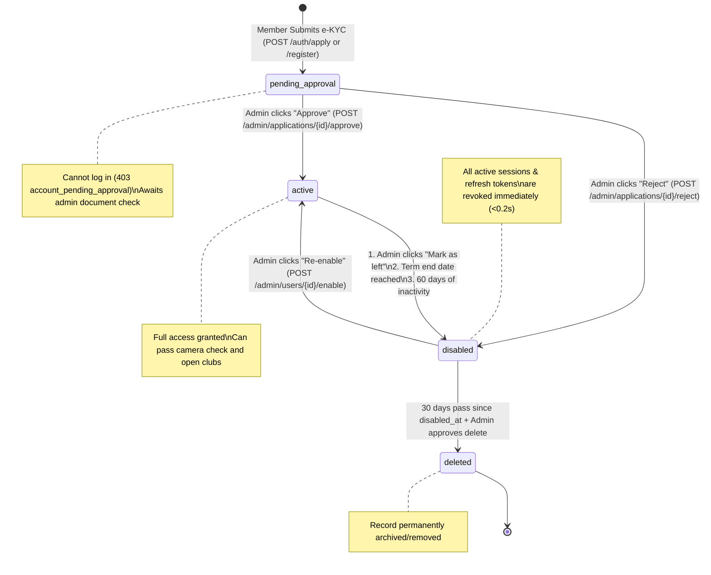

# data-model.md — Relational Database Schema & Data Dictionary

**Project:** Real Person, Real Access · **Product:** Sankalp SSO  
**Team:** Sankalp (Shreyans Dey, Arka Paul) · **Event:** Hack N Pitch 2026, Jadavpur University E-Cell  

---

## 1. Entity-Relationship (ER) Diagram

The Sankalp SSO database consists of **9 interconnected tables** designed for relational integrity, auditability, and instant revocation capability.

```mermaid
erDiagram
    USERS ||--o{ SSO_SESSIONS : "has active"
    USERS ||--o{ AUTH_CODES : "issued"
    USERS ||--o{ REFRESH_TOKENS : "owns"
    USERS ||--o{ LIVENESS_CHALLENGES : "answers"
    USERS ||--o{ PASSWORD_RESET_TOKENS : "requests"
    USERS ||--o{ INVITES : "created by admin"
    PRODUCTS ||--o{ AUTH_CODES : "received for"
    PRODUCTS ||--o{ REFRESH_TOKENS : "holds for"
    USERS ||--o{ AUDIT_LOG : "actor or target"

    USERS {
        string id PK "UUID (36 chars)"
        string email UK "Student / Admin email (Indexed)"
        string name "Full Name"
        string phone "Contact number"
        string password_hash "Argon2id password hash"
        string role "Role: admin or member"
        string status "Status: pending_approval, active, disabled, deleted"
        date term_end "Membership expiration date"
        datetime last_active_at "Last recorded activity"
        datetime liveness_passed_at "Last passed liveness"
        datetime disabled_at "When account was disabled"
        string disabled_reason "Reason: left, term_end, inactive, admin"
        json face_embedding "128D Unit-Normalized SFace Vector"
        string document_path "Relative path to uploaded student ID"
        string face_photo_path "Relative path to enrollment face photo"
        datetime approved_at "When admin approved e-KYC"
        string approved_by FK "Admin User ID who approved"
        datetime created_at "Account creation timestamp"
    }

    INVITES {
        string id PK "UUID (36 chars)"
        string email "Target invite email (Indexed)"
        string role "Assigned role: member or admin"
        date term_end "Pre-assigned membership end date"
        string token_hash UK "SHA-256 hash of raw invite token"
        datetime expires_at "Token expiration (7 days)"
        datetime used_at "When invite was accepted"
        string created_by FK "Admin User ID who created"
    }

    PRODUCTS {
        string id PK "UUID (36 chars)"
        string name "Club application name (e.g. Photography)"
        string client_id UK "Unique OAuth client ID (Indexed)"
        string client_secret_hash "Argon2 / SHA-256 secret hash"
        string redirect_uri "Whitelisted OAuth callback URL"
    }

    SSO_SESSIONS {
        string id PK "UUID (36 chars) / Cookie value"
        string user_id FK "User ID (Indexed)"
        datetime created_at "Session start timestamp"
        datetime expires_at "Session end timestamp (8 hours)"
        datetime revoked_at "Timestamp when session was revoked"
        string ip "Client IP address"
        string user_agent "Client browser User-Agent"
    }

    AUTH_CODES {
        string id PK "UUID (36 chars)"
        string user_id FK "User ID (Indexed)"
        string product_id FK "Product ID (Indexed)"
        string code_hash UK "SHA-256 hash of one-time code"
        datetime expires_at "Expiration timestamp (60 seconds)"
        datetime used_at "When code was exchanged"
    }

    REFRESH_TOKENS {
        string id PK "UUID (36 chars)"
        string user_id FK "User ID (Indexed)"
        string product_id FK "Product ID (Indexed)"
        string token_hash UK "SHA-256 hash of refresh token"
        datetime expires_at "Expiration timestamp (30 days)"
        datetime revoked_at "Timestamp when token was revoked"
    }

    LIVENESS_CHALLENGES {
        string id PK "UUID (36 chars)"
        string user_id FK "User ID (Indexed)"
        string type "Challenge type: turn_left, turn_right, blink"
        string code_hash "SHA-256 hash of 6-digit code"
        datetime expires_at "Expiration timestamp (30 seconds)"
        datetime used_at "When challenge was submitted"
        string result "Result: pass, fail, or null"
    }

    PASSWORD_RESET_TOKENS {
        string id PK "UUID (36 chars)"
        string user_id FK "User ID (Indexed)"
        string token_hash UK "SHA-256 hash of reset token"
        datetime expires_at "Expiration timestamp (15 minutes)"
        datetime used_at "When token was consumed"
        datetime created_at "Creation timestamp"
    }

    AUDIT_LOG {
        string id PK "UUID (36 chars)"
        datetime at "Timestamp of event (Indexed)"
        string actor_id "User ID who performed action"
        string action "Fixed audit action name"
        string target_id "Entity ID affected by action"
        json detail "Sanitized event context JSON"
    }
```

---

## 2. Comprehensive Data Dictionary (Table by Table)

### 2.1. Table: `users`
Stores all registered identities, credentials, account status, and biometric enrollment data.

| Column | Data Type | Constraints | Description & Purpose (Plain English) |
|---|---|---|---|
| `id` | `VARCHAR(36)` | Primary Key | Universally Unique Identifier (UUID v4) representing the user account. |
| `email` | `VARCHAR(255)` | Unique, Not Null, Indexed | The user's primary institutional email address. Used as login username. |
| `name` | `VARCHAR(255)` | Not Null | The member's full legal name. |
| `phone` | `VARCHAR(50)` | Nullable | Optional contact phone number entered during registration. |
| `password_hash` | `VARCHAR(255)` | Not Null | One-way cryptographic hash of the user's password using the **Argon2id** algorithm. Raw passwords are never stored. |
| `role` | `VARCHAR(50)` | Not Null, Default: `'member'` | Permission role: `'member'` (standard student) or `'admin'` (faculty / club executive). |
| `status` | `VARCHAR(50)` | Not Null, Default: `'active'` | Lifecycle status: `'pending_approval'`, `'active'`, `'disabled'`, or `'deleted'`. |
| `term_end` | `DATE` | Nullable | The calendar date when membership expires (e.g. Student graduation date). |
| `last_active_at` | `DATETIME` | Nullable | Timestamp of the user's most recent interaction or token refresh. Used by the inactivity cleanup job. |
| `liveness_passed_at` | `DATETIME` | Nullable | Timestamp when the user last completed a physical camera liveness check. |
| `disabled_at` | `DATETIME` | Nullable | Timestamp when the account was disabled (via admin action, term end, or inactivity). Starts the 30-day deletion countdown. |
| `disabled_reason` | `VARCHAR(50)` | Nullable | Reason for deactivation: `'left'`, `'term_end'`, `'inactive'`, `'admin'`, or `'application_rejected'`. |
| `face_embedding` | `JSON` | Nullable | A list of 128 floating-point numbers representing the unit-normalized deep biometric embedding extracted by SFace. |
| `document_path` | `VARCHAR(500)` | Nullable | Relative disk path to the member's uploaded student ID card image (for admin verification). |
| `face_photo_path` | `VARCHAR(500)` | Nullable | Relative disk path to the member's live webcam enrollment portrait. |
| `approved_at` | `DATETIME` | Nullable | Timestamp when an administrator approved the student's e-KYC application. |
| `approved_by` | `VARCHAR(36)` | Nullable, Foreign Key (`users.id`) | User ID of the administrator who reviewed and approved the application. |
| `created_at` | `DATETIME` | Not Null, Default: `UTC_NOW` | Timestamp when the account record was created. |

---

### 2.2. Table: `invites`
Stores pre-authorized invitations dispatched by administrators to prospective members.

| Column | Data Type | Constraints | Description & Purpose (Plain English) |
|---|---|---|---|
| `id` | `VARCHAR(36)` | Primary Key | Unique UUID for the invitation record. |
| `email` | `VARCHAR(255)` | Not Null, Indexed | The email address authorized to accept this invitation. |
| `role` | `VARCHAR(50)` | Not Null, Default: `'member'` | The role that will be assigned upon acceptance (`'member'` or `'admin'`). |
| `term_end` | `DATE` | Nullable | Pre-set expiration date applied to the member account once created. |
| `token_hash` | `VARCHAR(255)` | Unique, Not Null, Indexed | SHA-256 hash of the 32-byte raw invite secret embedded in the invite link. |
| `expires_at` | `DATETIME` | Not Null | Expiration timestamp (default: 7 days after creation). Expired invites cannot be used. |
| `used_at` | `DATETIME` | Nullable | Timestamp when the invite was redeemed during registration. Prevents replay attacks. |
| `created_by` | `VARCHAR(36)` | Nullable, Foreign Key (`users.id`) | User ID of the administrator who issued the invitation. |

---

### 2.3. Table: `products`
Stores registered third-party campus applications (such as Photography Club, Robotics Lab) authorized to use Sankalp SSO.

| Column | Data Type | Constraints | Description & Purpose (Plain English) |
|---|---|---|---|
| `id` | `VARCHAR(36)` | Primary Key | Unique UUID for the registered product. |
| `name` | `VARCHAR(255)` | Not Null | Human-readable name of the application (e.g. "Photography Club"). |
| `client_id` | `VARCHAR(100)` | Unique, Not Null, Indexed | Public alphanumeric identifier supplied by the product during OAuth requests. |
| `client_secret_hash` | `VARCHAR(255)` | Not Null | Cryptographic hash of the application's private client secret key. |
| `redirect_uri` | `VARCHAR(500)` | Not Null | The exact callback URL where authorization codes are permitted to be delivered. |

---

### 2.4. Table: `sso_sessions`
Tracks active central Single Sign-On browser sessions.

| Column | Data Type | Constraints | Description & Purpose (Plain English) |
|---|---|---|---|
| `id` | `VARCHAR(36)` | Primary Key | Random UUID string stored inside the client's `sso_session` cookie. |
| `user_id` | `VARCHAR(36)` | Not Null, Foreign Key (`users.id`), Indexed | The user who owns this session. |
| `created_at` | `DATETIME` | Not Null, Default: `UTC_NOW` | When the session started. |
| `expires_at` | `DATETIME` | Not Null | When the session expires (default: 8 hours after login). |
| `revoked_at` | `DATETIME` | Nullable | Timestamp if the session was prematurely terminated (e.g. Logout or "Mark as left"). |
| `ip` | `VARCHAR(100)` | Nullable | Client IP address recorded for security audit purposes. |
| `user_agent` | `TEXT` | Nullable | Client browser identity string recorded for anomaly detection. |

---

### 2.5. Table: `auth_codes`
Stores temporary, single-use OAuth 2.0 authorization codes exchanged between the gateway and connected products.

| Column | Data Type | Constraints | Description & Purpose (Plain English) |
|---|---|---|---|
| `id` | `VARCHAR(36)` | Primary Key | Unique UUID for the authorization code entry. |
| `user_id` | `VARCHAR(36)` | Not Null, Foreign Key (`users.id`), Indexed | The authenticated user authorizing access. |
| `product_id` | `VARCHAR(36)` | Not Null, Foreign Key (`products.id`), Indexed | The specific campus club application receiving access. |
| `code_hash` | `VARCHAR(255)` | Unique, Not Null, Indexed | SHA-256 hash of the 24-character code delivered in the redirect URL. |
| `expires_at` | `DATETIME` | Not Null | Expiration timestamp. Strictly limited to **60 seconds**. |
| `used_at` | `DATETIME` | Nullable | Timestamp when exchanged via `POST /token`. Codes can only be redeemed once. |

---

### 2.6. Table: `refresh_tokens`
Stores long-lived, revocable tokens that allow connected applications to maintain active access without prompting the user.

| Column | Data Type | Constraints | Description & Purpose (Plain English) |
|---|---|---|---|
| `id` | `VARCHAR(36)` | Primary Key | Unique UUID for the refresh token record. |
| `user_id` | `VARCHAR(36)` | Not Null, Foreign Key (`users.id`), Indexed | The member account tied to this token. |
| `product_id` | `VARCHAR(36)` | Not Null, Foreign Key (`products.id`), Indexed | The connected club application granted token refresh rights. |
| `token_hash` | `VARCHAR(255)` | Unique, Not Null, Indexed | SHA-256 hash of the high-entropy 32-byte refresh token. |
| `expires_at` | `DATETIME` | Not Null | Expiration timestamp (default: 30 days). |
| `revoked_at` | `DATETIME` | Nullable | Timestamp if explicitly revoked (e.g. When member is marked as left). |

---

### 2.7. Table: `liveness_challenges`
Tracks server-generated physical camera challenges issued during login.

| Column | Data Type | Constraints | Description & Purpose (Plain English) |
|---|---|---|---|
| `id` | `VARCHAR(36)` | Primary Key | Unique UUID identifying the challenge session. |
| `user_id` | `VARCHAR(36)` | Not Null, Foreign Key (`users.id`), Indexed | The user attempting to verify presence. |
| `type` | `VARCHAR(50)` | Not Null | The randomly assigned challenge direction: `'turn_left'` or `'turn_right'`. |
| `code_hash` | `VARCHAR(255)` | Not Null | SHA-256 hash of the 6-digit one-time numeric verification code. |
| `expires_at` | `DATETIME` | Not Null | Expiration timestamp. Strictly limited to **30 seconds**. |
| `used_at` | `DATETIME` | Nullable | Timestamp when submitted by the browser. |
| `result` | `VARCHAR(50)` | Nullable | Verification result: `'pass'`, `'fail'`, or `NULL` if abandoned. |

---

### 2.8. Table: `password_reset_tokens`
Stores single-use security tokens issued during self-service password recovery workflows.

| Column | Data Type | Constraints | Description & Purpose (Plain English) |
|---|---|---|---|
| `id` | `VARCHAR(36)` | Primary Key | Unique UUID identifying the reset token request. |
| `user_id` | `VARCHAR(36)` | Not Null, Foreign Key (`users.id`), Indexed | The account requesting a password change. |
| `token_hash` | `VARCHAR(255)` | Unique, Not Null, Indexed | SHA-256 hash of the 32-byte cryptographic token dispatched via SMTP email. |
| `expires_at` | `DATETIME` | Not Null | Expiration timestamp. Strictly limited to **15 minutes**. |
| `used_at` | `DATETIME` | Nullable | Timestamp when consumed via `POST /auth/reset-password`. |
| `created_at` | `DATETIME` | Not Null, Default: `UTC_NOW` | Timestamp when the request was initiated. |

---

### 2.9. Table: `audit_log`
An immutable, append-only security ledger recording every administrative and authentication event.

| Column | Data Type | Constraints | Description & Purpose (Plain English) |
|---|---|---|---|
| `id` | `VARCHAR(36)` | Primary Key | Unique UUID for the audit record. |
| `at` | `DATETIME` | Not Null, Default: `UTC_NOW`, Indexed | Exact timestamp when the action occurred. |
| `actor_id` | `VARCHAR(36)` | Nullable, Indexed | User ID of the person or system process performing the action. |
| `action` | `VARCHAR(50)` | Not Null, Indexed | Standardized action identifier from the fixed catalog (see Section 4). |
| `target_id` | `VARCHAR(36)` | Nullable, Indexed | User ID or Product ID affected by the action. |
| `detail` | `JSON` | Nullable | Sanitized JSON dictionary containing contextual metadata (IP, email, reasons). |

---

## 3. Account Lifecycle State Machine

The account status progresses through a rigorous, unidirectional lifecycle to guarantee security and data preservation:

---

## 4. The 20 Fixed Audit Actions Catalog

To prevent tampering or inconsistent log entries, the backend strictly validates incoming audit events against a **fixed set of 20 action identifiers**:

| # | Action Identifier | Triggering Event | Actor (`actor_id`) | Target (`target_id`) | Sample Detail Payload |
|---|---|---|---|---|---|
| 1 | `invite_created` | Admin generates an invitation link | Admin User ID | None | `{"email": "student@ju.edu", "role": "member"}` |
| 2 | `application_submitted` | Candidate completes e-KYC registration | Applicant User ID | Applicant User ID | `{"email": "student@ju.edu", "status": "pending_approval"}` |
| 3 | `application_approved` | Admin approves pending e-KYC application | Admin User ID | Approved User ID | `{"approved_by": "admin@ju.edu"}` |
| 4 | `application_rejected` | Admin rejects e-KYC application | Admin User ID | Rejected User ID | `{"reason": "Invalid document proof"}` |
| 5 | `signup` | Applicant account created from invite | User ID | User ID | `{"email": "student@ju.edu"}` |
| 6 | `login_ok` | Successful credentials and session check | User ID | None | `{"method": "sso_session"}` |
| 7 | `login_fail` | Incorrect password or unknown email | User ID / None | None | `{"attempted_email": "intruder@evil.com"}` |
| 8 | `liveness_pass` | User passes 3-step camera challenge | User ID | Challenge ID | `{"challenge_type": "turn_left"}` |
| 9 | `liveness_fail` | User fails camera challenge or timeout | User ID | Challenge ID | `{"reason": "timeout_or_jitter"}` |
| 10 | `face_match_fail` | Biometric Cosine Similarity $< 0.40$ | User ID | None | `{"similarity": 0.21, "threshold": 0.40}` |
| 11 | `password_reset_requested`| User submits forgot password form | User ID | None | `{"email": "student@ju.edu"}` |
| 12 | `password_reset_completed`| Password updated via valid token | User ID | None | `{"sessions_revoked": true}` |
| 13 | `token_issued` | Access token exchanged via OAuth code | User ID | Product ID | `{"product": "Photography Club"}` |
| 14 | `access_denied` | Disabled or pending user attempts access | User ID | Product ID | `{"reason": "account_disabled"}` |
| 15 | `user_marked_left` | Admin manually revokes departing user | Admin User ID | User ID | `{"user_email": "rahul@ju.edu"}` |
| 16 | `user_disabled_auto` | Cleanup daemon disables expired user | `"system_cleanup_job"` | User ID | `{"reason": "term_end"}` |
| 17 | `user_enabled` | Admin restores a disabled account | Admin User ID | User ID | `{"user_email": "rahul@ju.edu"}` |
| 18 | `delete_requested` | Admin marks disabled account for deletion | Admin User ID | User ID | `{"days_disabled": 32}` |
| 19 | `delete_approved` | Admin confirms permanent account deletion | Admin User ID | User ID | `{"permanent": true}` |
| 20 | `product_registered` | Admin registers a new campus club app | Admin User ID | Product ID | `{"client_id": "app-f", "name": "Music Club"}` |
