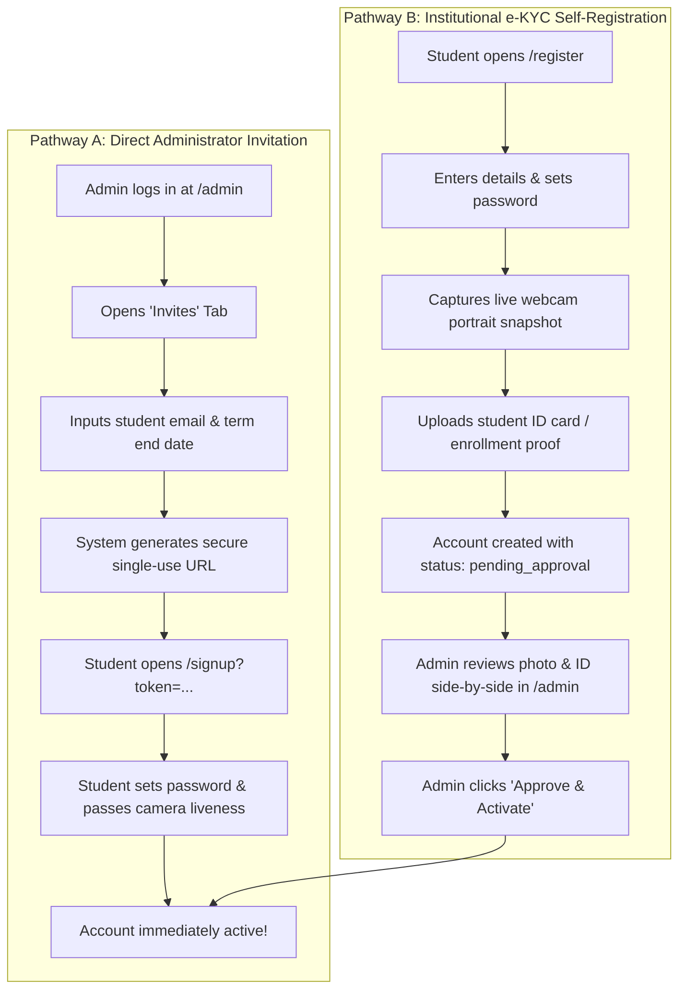

# production-deployment.md — Production Hosting & Zero-Demo-User Setup Guide

**Project:** Real Person, Real Access · **Product:** Sankalp SSO  
**Team:** Sankalp (Shreyans Dey, Arka Paul) · **Track:** Cybersecurity & Digital Identity  

---

## 🎯 1. Overview & Production Guarantees

In development or hackathon demo mode, the database contains mock sample users (such as Rahul, Arun, and Pooja) and predefined demo passwords. 

When deploying **Sankalp SSO** to a real university, campus club, or enterprise production server:
1. **Zero Demo Users**: No dummy records, mock members, or pre-seeded test accounts exist in the database.
2. **One Real Administrator**: Bootstrapped securely using credentials provided in environment variables with Argon2id password hashing.
3. **All Real Users**: Real students and faculty join exclusively through **Admin Onboarding Invites** or the **e-KYC Photographic Review Desk**.
4. **PostgreSQL Relational Storage**: Full multi-container PostgreSQL persistence with isolated volume mounts.
5. **HTTPS & Camera Security**: Enforced TLS 1.3 encryption required by browser WebRTC/MediaPipe APIs for webcam access.

---

## 🖥️ 2. Server Requirements & OS Prerequisites

| Resource | Minimum Requirement | Recommended Specification |
|---|---|---|
| **Operating System** | Ubuntu 22.04 / 24.04 LTS, Debian 12, or Rocky Linux 9 | Ubuntu 24.04 LTS x86_64 |
| **CPU** | 2 vCPUs (x86_64 or ARM64) | 4 vCPUs (for concurrent YuNet/SFace inference) |
| **RAM** | 4 GB | 8 GB |
| **Storage** | 25 GB SSD | 50 GB+ NVMe SSD (for persistent e-KYC documents) |
| **Network** | Static Public IPv4, Ports 80 & 443 open | Domain name (e.g., `sso.youruniversity.edu`) |

### Install Docker Engine & Compose on Server
```bash
# 1. Update apt repositories
sudo apt-get update
sudo apt-get install -y ca-certificates curl gnupg lsb-release

# 2. Add Docker official GPG key and repository
sudo mkdir -p /etc/apt/keyrings
curl -fsSL https://download.docker.com/linux/ubuntu/gpg | sudo gpg --dearmor -o /etc/apt/keyrings/docker.gpg
echo \
  "deb [arch=$(dpkg --print-architecture) signed-by=/etc/apt/keyrings/docker.gpg] https://download.docker.com/linux/ubuntu \
  $(lsb_release -cs) stable" | sudo tee /etc/apt/sources.list.d/docker.list > /dev/null

# 3. Install Docker Engine and Docker Compose Plugin
sudo apt-get update
sudo apt-get install -y docker-ce docker-ce-cli containerd.io docker-buildx-plugin docker-compose-plugin

# 4. Enable and start Docker service
sudo systemctl enable --now docker
```

---

## ⚙️ 3. Environment Configuration (`.env`)

Clone your repository to the server and configure `.env`:

```bash
# Navigate to deployment directory
cd /opt/sankalp-sso

# Copy the production template
cp .env.production.example .env

# Generate a cryptographically secure 64-character JWT secret
openssl rand -hex 32
```

Edit `.env` using your editor (`nano .env` or `vim .env`):

```ini
# ------------------------------------------------------------------------------
# 1. Production Mode
# ------------------------------------------------------------------------------
ENVIRONMENT=production
BOOTSTRAP_PROD=true
ENABLE_SCHEDULER=true

# ------------------------------------------------------------------------------
# 2. PostgreSQL Configuration
# ------------------------------------------------------------------------------
POSTGRES_USER=sankalp_admin
POSTGRES_PASSWORD=EnterYourStrongDatabasePasswordHere
POSTGRES_DB=sankalp_production

# ------------------------------------------------------------------------------
# 3. Security Secrets & Lifetimes
# ------------------------------------------------------------------------------
JWT_SECRET=PasteYourGenerated64CharHexKeyHere
ACCESS_TOKEN_MINUTES=10
SSO_SESSION_HOURS=8
INACTIVITY_DAYS=60
PURGE_GRACE_HOURS=48

# ------------------------------------------------------------------------------
# 4. Domains & Allowed CORS Origins (Replace with your actual HTTPS domains)
# ------------------------------------------------------------------------------
FRONTEND_ORIGIN=https://sso.youruniversity.edu
APP_A_ORIGIN=https://photo.youruniversity.edu
APP_B_ORIGIN=https://robotics.youruniversity.edu

# ------------------------------------------------------------------------------
# 5. REAL ADMINISTRATOR CREDENTIALS (Zero Demo Users)
# ------------------------------------------------------------------------------
ADMIN_EMAIL=admin@youruniversity.edu
ADMIN_NAME=Chief Information Security Officer
ADMIN_PASSWORD=EnterYourSuperSecureAdminPassword123!

# ------------------------------------------------------------------------------
# 6. Real SMTP Server (For Password Resets & Expiry Notices)
# ------------------------------------------------------------------------------
SMTP_HOST=smtp.gmail.com
SMTP_PORT=587
SMTP_USER=sso-notifications@youruniversity.edu
SMTP_PASS=your-smtp-app-password
SMTP_SECURE=tls
EMAIL_FROM=sso-notifications@youruniversity.edu
EMAIL_FROM_NAME=Real Access (University SSO)
```

---

## 🚀 4. Deployment via Docker Compose

Run the production stack:

```bash
# 1. Build and boot all production containers in background
docker compose -f docker-compose.prod.yml up -d --build

# 2. Verify containers are healthy and running
docker compose -f docker-compose.prod.yml ps

# 3. Inspect backend bootstrap logs to confirm 0 demo users
docker logs sankalp_prod_backend
```

### Expected Output in Logs:
```
================================================================================
 SANKALP SSO — PRODUCTION DATABASE BOOTSTRAP
================================================================================
 [MODE] Pure Production Environment
 [GUARANTEE] 0 Demo Users will be created. Clean slate for real members only.

 1. Initializing database schema and running column verifications...
    Schema is up-to-date.
    Created Real Administrator: admin@youruniversity.edu

 2. Registering Connected Products / Campus Facilities...
    Registered Product: Photography Club Portal (app-a)
    Registered Product: Robotics Research Lab (app-b)
    Registered Product: Coding & AI Society (app-c)
    Registered Product: Chess & Mind Sports (app-d)
    Registered Product: Athletics & Sports Complex (app-e)

================================================================================
 🎉 PRODUCTION BOOTSTRAP COMPLETE!
 • Admin Email:       admin@youruniversity.edu
 • Password:          [SECURED WITH ARGON2ID HASH]
 • Demo Users:        0 (Database is 100% clean)
 • Real Users:        Ready for real registration & invites
================================================================================
```

---

## 🌐 5. Domain & Reverse Proxy Configuration (Nginx + SSL)

Modern web browsers **strictly require HTTPS** to allow webcam streaming (`navigator.mediaDevices.getUserMedia`). For production, install Nginx on the host and issue Let's Encrypt TLS certificates.

### Step 5.1: Install Nginx & Certbot
```bash
sudo apt-get install -y nginx certbot python3-certbot-nginx
```

### Step 5.2: Configure Nginx Virtual Host
Create `/etc/nginx/sites-available/sankalp-sso`:

```nginx
# Rate limiting zone (20 requests per second per IP)
limit_req_zone $binary_remote_addr zone=sso_limit:10m rate=20r/s;

server {
    server_name sso.youruniversity.edu;

    # Frontend Single Page Application (Port 5180)
    location / {
        limit_req zone=sso_limit burst=30 nodelay;
        proxy_pass http://127.0.0.1:5180;
        proxy_http_version 1.1;
        proxy_set_header Upgrade $http_upgrade;
        proxy_set_header Connection 'upgrade';
        proxy_set_header Host $host;
        proxy_cache_bypass $http_upgrade;
    }

    # Backend API endpoints (Port 8001)
    location ~ ^/(auth|liveness|admin|authorize|token|me|health) {
        limit_req zone=sso_limit burst=20 nodelay;
        proxy_pass http://127.0.0.1:8001;
        proxy_http_version 1.1;
        proxy_set_header Host $host;
        proxy_set_header X-Real-IP $remote_addr;
        proxy_set_header X-Forwarded-For $proxy_add_x_forwarded_for;
        proxy_set_header X-Forwarded-Proto $scheme;

        # Critical: allow HttpOnly session cookies across origins
        proxy_cookie_path / "/; Secure; HttpOnly; SameSite=Lax";
        client_max_body_size 15M; # Allow webcam snapshot + document uploads
    }
}
```

### Step 5.3: Enable Site & Issue Free SSL Certificate
```bash
sudo ln -s /etc/nginx/sites-available/sankalp-sso /etc/nginx/sites-enabled/
sudo nginx -t
sudo systemctl reload nginx

# Issue Let's Encrypt TLS Certificate (Automatic HTTPS)
sudo certbot --nginx -d sso.youruniversity.edu
```

---

## 👥 6. Onboarding Real Users in Production

Once deployed, real users join the system through one of two authorized pathways:



### Pathway A: Direct Administrator Invitation (Fast Track)
1. The Real Administrator logs in at `https://sso.youruniversity.edu/login` with `ADMIN_EMAIL` and `ADMIN_PASSWORD`.
2. Completes the active liveness camera verification.
3. Navigates to **Admin Command Desk** → **Invites** tab.
4. Clicks **+ Invite Member**, enters the student's email and their term expiration date (e.g. `2027-06-30`).
5. Copies the generated link (`https://sso.youruniversity.edu/signup?token=...`) and sends it to the student.
6. The student sets their password, completes the liveness check, and has immediate access.

### Pathway B: Institutional e-KYC Self-Registration (Review Desk)
1. Students navigate to `https://sso.youruniversity.edu/register`.
2. They enter their name, university email, phone number, and password.
3. The browser captures a live webcam photo and extracts the unit-normalized 128D facial feature vector.
4. The student uploads a clear photo or PDF of their University Student ID Card.
5. The account is set to `pending_approval` and login is temporarily restricted.
6. The Administrator opens **Pending Approvals** on the Admin Console, reviews the live face alongside the physical ID card, and clicks **Approve & Activate**.

---

## 💾 7. Production Backup & Disaster Recovery

### 7.1. Database Backups (Automated Daily Cron)
Create a backup script `/opt/sankalp-sso/scripts/backup.sh`:

```bash
#!/bin/bash
BACKUP_DIR="/opt/sankalp-backups"
TIMESTAMP=$(date +"%Y%m%d_%H%M%S")
mkdir -p "$BACKUP_DIR"

# Dump PostgreSQL database
docker exec sankalp_prod_db pg_dump -U sankalp_admin sankalp_production | gzip > "$BACKUP_DIR/db_$TIMESTAMP.sql.gz"

# Keep last 14 days of backups
find "$BACKUP_DIR" -type f -name "*.sql.gz" -mtime +14 -delete
```

Add to crontab (`crontab -e`):
```cron
0 3 * * * /opt/sankalp-sso/scripts/backup.sh
```

### 7.2. Document Vault Backup
The physical storage volume `sankalp_uploads_vault` stores encrypted user proof documents and facial snapshot vectors. Back it up to an off-site S3-compatible bucket or external volume:

```bash
# Archive upload volume
docker run --rm -v sankalp_uploads_vault:/data -v /opt/sankalp-backups:/backup alpine tar czf /backup/vault_$(date +%Y%m%d).tar.gz /data
```

---

## 🔒 8. Production Security Verification Checklist

Before announcing the service to students, verify all items:

- [ ] `ENVIRONMENT=production` is active in `.env`.
- [ ] No demo users exist (`python backend/check_db.py` confirms 0 mock accounts).
- [ ] PostgreSQL is used instead of SQLite (`DATABASE_URL` starts with `postgresql://`).
- [ ] Admin default credentials have been changed to a strong, unguessable password.
- [ ] All traffic is forced through HTTPS with valid SSL certificates.
- [ ] Webcam access operates cleanly on the HTTPS domain without browser security warnings.
- [ ] APScheduler automated janitor daemon is active in the background (`ENABLE_SCHEDULER=true`).
- [ ] SMTP email dispatch functions properly for password resets and 48-hour recovery notices.
