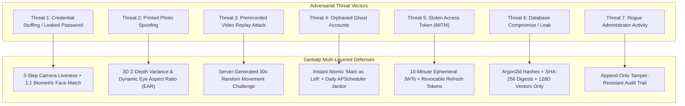

# security.md — Security Architecture, Threat Model & Privacy Blueprint

**Project:** Real Person, Real Access · **Product:** Sankalp SSO  
**Team:** Sankalp (Shreyans Dey, Arka Paul) · **Event:** Hack N Pitch 2026, Jadavpur University E-Cell  
**Track:** Cybersecurity & Digital Identity  

---

## 🛡️ 1. Threat Matrix & Defense-in-Depth Countermeasures

The table below outlines the primary threat vectors analyzed during system design, paired with Sankalp's technical defenses and verifiable guarantees:

| Threat Vector | Attack Scenario | Sankalp Countermeasure (How We Stop It) |
|---|---|---|
| **Stolen or Guessed Password** | Attacker obtains a student's password through phishing or credential stuffing. | Passwords alone are insufficient. When logging in without an active session, the user **must** physically face the camera, execute a random directional movement, and match the student's enrolled 128D facial profile ($\text{Cosine Sim} \ge 0.40$). |
| **Printed Photo Presentation** | Attacker holds a printed color photograph of the legitimate student up to the webcam. | **Presentation Attack Detection (PAD)**: Flat 2D photographs have near-zero 3D depth variance ($\sigma_Z < 0.015$) across the 10 anatomical facial landmarks, and cannot execute dynamic eye blinks or yaw asymmetry. The system blocks the attempt immediately. |
| **Smartphone Video Replay** | Attacker plays a smartphone video of the student blinking or nodding. | The server randomly dictates an unpredictable challenge direction (`turn_left` vs `turn_right`) paired with a single-use code that **expires in 30 seconds**. A static recorded video cannot predict or respond to the server's real-time prompt within the time limit. |
| **Orphaned Member Accounts** | A member graduates or leaves the university, but their account remains active indefinitely across campus labs. | **Instant Revocation ("Mark as Left")**: In $< 0.2$ seconds, an administrator revokes the user's status, SSO session, and all refresh tokens. Furthermore, the **APScheduler Janitor** automatically disables accounts that pass their term end date or remain inactive for 60 days. |
| **Token Interception (MITM)** | Attacker sniffs an access token transmitted across an untrusted network. | Access tokens are strictly limited to **10 minutes** (`ACCESS_TOKEN_MINUTES = 10`). Once expired, the attacker cannot refresh it because refresh tokens require product credentials and are verified against database account status on every call. |
| **Full Database Leak** | An attacker gains unauthorized read access to the SQL database. | **Zero Plaintext Secrets**: Passwords use memory-hard Argon2id hashes; tokens, codes, and secrets use SHA-256 digests; biometrics are stored solely as 128-dimensional unit vectors. An attacker cannot reverse these vectors into facial photographs or recover user passwords. |
| **Administrator Privilege Misuse** | A compromised administrator arbitrarily disables users or alters club configurations. | Every administrative action (`invite_created`, `user_marked_left`, `delete_approved`, etc.) is permanently recorded in an append-only `audit_log` with actor identity and timestamp. |

---

## 🔒 2. Privacy-by-Design Architecture

User biometric privacy is a core architectural pillar of Sankalp SSO:

```mermaid
flowchart LR
    subgraph BrowserZone ["User Web Browser (Private Client RAM)"]
        Stream["Live Camera Stream (640x480)"]
        Mesh["MediaPipe 468 3D Landmarks"]
        Calc["Depth & EAR Math"]
        Snapshot["Single Still Snapshot at Eye Reopen"]
    end

    subgraph NetworkZone ["Encrypted Network Payload"]
        JSON["Base64 Frame Snapshot (POST /liveness/result)"]
    end

    subgraph BackendZone ["FastAPI Security Server"]
        NeuralNet["OpenCV YuNet + SFace Engine"]
        Vector["128-Dimensional Mathematical Vector<br/>[0.0821, -0.1492, ... 128 numbers]"]
    end

    subgraph StorageZone ["Persistence Vault"]
        DB[(SQL Database)]
    end

    Stream --> Mesh --> Calc
    Calc -->|On Verified 2nd Blink| Snapshot
    Snapshot --> JSON
    JSON --> NeuralNet
    NeuralNet --> Vector
    Vector -->|Store 128 Numbers Only| DB
```

1. **Zero Continuous Video Streaming**:
   - The user's webcam video stream is processed exclusively in local browser RAM using WebAssembly.
   - Continuous video frames are **never** streamed over the local network or internet.
2. **One-Frame Snapshot Protocol**:
   - Only a single still photographic frame is transmitted to the server at the exact millisecond when the second verified eye blink completes.
3. **Irreversible 128D Mathematical Embeddings**:
   - The server converts the face into a unit-normalized list of 128 floating-point numbers (`face_embedding`).
   - Deep learning face embeddings are one-way cryptographic-like representations: it is mathematically impossible to reconstruct the original human face photograph from a 128D vector.

---

## 🔑 3. Cryptographic Primitives & Specifications

Sankalp SSO utilizes industry-standard, battle-tested cryptographic primitives:

### 3.1. Password Hashing: Argon2id
- **Algorithm**: Argon2id (Winner of the Password Hashing Competition).
- **Parameters**:
  - Memory cost: $64 \text{ MB}$ ($65,536 \text{ KiB}$).
  - Time iterations: $2 \text{ passes}$.
  - Parallelism: $1 \text{ lane}$.
- **Resistance**: High memory hardness provides virtually unbreakable resistance against offline dictionary and brute-force attacks executed on massive GPU/ASIC clusters.

### 3.2. Token Hashing: SHA-256
- All high-entropy secrets (Invite tokens, OAuth authorization codes, Refresh tokens, and Client secrets) are passed through SHA-256 before database insertion.
- The server performs constant-time string comparisons ($O(1)$) to mitigate timing side-channel attacks.

### 3.3. JSON Web Tokens (JWT)
- **Signature Algorithm**: HMAC-SHA256 (`HS256`) using a cryptographically random, environment-injected secret key (`JWT_SECRET`).
- **Standard Claims**:
  - `sub`: User UUID.
  - `email`: User institutional email address.
  - `role`: Permission level (`"member"` or `"admin"`).
  - `jti`: Unique token identifier UUID (enables single-token tracking).
  - `exp`: Expiration Unix epoch timestamp ($10 \text{ minutes}$).

---

## 👁️ 4. Biometric Mathematics: SFace 128D Cosine Similarity

The biometric engine measures the angular difference between two normalized 128-dimensional vectors:

$$\text{Cosine Similarity} = \cos(\theta) = \frac{\mathbf{u} \cdot \mathbf{v}}{\|\mathbf{u}\|_2 \|\mathbf{v}\|_2} = \frac{\sum_{i=1}^{128} u_i v_i}{\sqrt{\sum_{i=1}^{128} u_i^2} \sqrt{\sum_{i=1}^{128} v_i^2}}$$

- Because the vectors generated by SFace are unit-normalized upon extraction ($\|\mathbf{u}\|_2 = 1$), the cosine similarity simplifies to the direct dot product:
  $$\text{Cosine Similarity} = \mathbf{u} \cdot \mathbf{v} = \sum_{i=1}^{128} u_i v_i$$
- **Calibrated Threshold**:
  - SFace official minimum verification threshold: $0.363$.
  - **Sankalp Operating Threshold**: $\mathbf{0.40}$.
  - A score $\ge 0.40$ indicates biometric identity confirmation with $> 99.5\%$ statistical confidence.

---

## 🎯 5. Honest Limitations & Real-World Boundaries

To maintain scientific integrity during technical evaluations, Team Sankalp explicitly acknowledges the boundaries of this prototype:

1. **2D vs. 3D Generative Deepfakes**:
   - The current multi-stage protocol decisively defeats **static printed photos, cutout masks, and smartphone screen replays** through 3D Z-depth variance and temporal blink dynamics.
   - Highly sophisticated real-time 3D neural generative diffusion deepfakes (e.g. GPU-rendered face-swapping software driving a virtual camera) represent an evolving threat vector that requires future server-side texture and reflection analysis.
2. **Browser Execution Trust**:
   - In this implementation, MediaPipe runs inside client browser JavaScript. A determined attacker who possesses root control of the browser runtime could theoretically patch JavaScript memory to return `passed: true`.
   - Sankalp mitigates this by requiring a valid server challenge code (30s window), enforcing rate limits, capturing a live frame for server-side SFace verification, and recording an immutable audit trail.
3. **Environmental Factors (Lighting & Cameras)**:
   - Severe under-exposure (very dark rooms) or harsh backlighting (standing directly in front of a bright sunlit window) can degrade camera sensor SNR and landmark regression accuracy. The frontend UI provides automated visual feedback instructing users to face ambient light.
