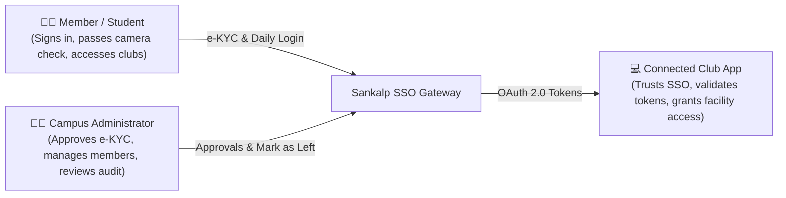
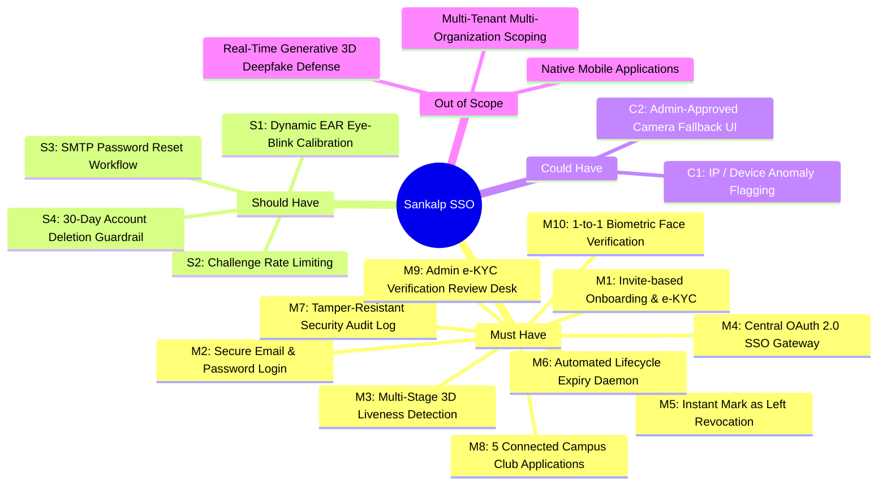
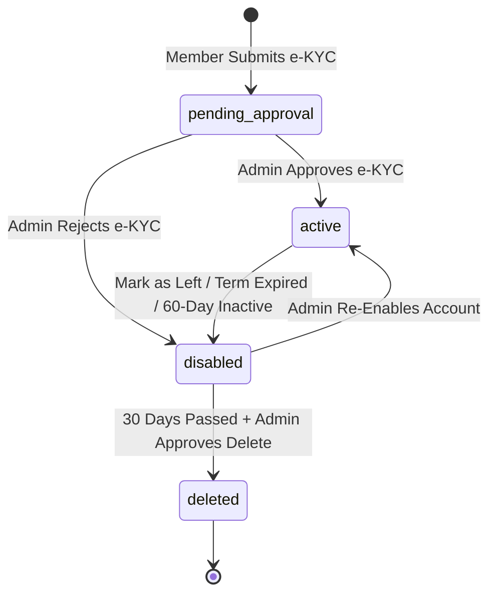
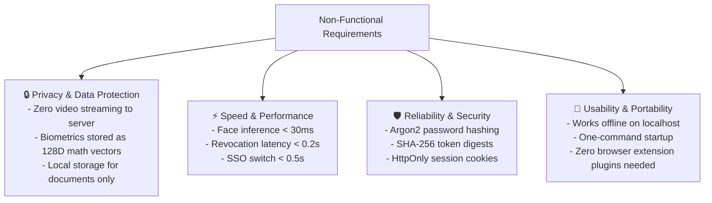

# srs.md — Software Requirements Specification

**Project:** Real Person, Real Access · **Product:** Sankalp SSO  
**Team:** Sankalp (Shreyans Dey, Arka Paul) · **Event:** Hack N Pitch 2026, Jadavpur University E-Cell  
**Track:** Cybersecurity & Digital Identity  

---

## 1. Executive Summary & Problem Statement

### 1.1. The Real-World Problem (Plain Words)
Universities, student clubs, and small organizations struggle with two fundamental identity security flaws:
1. **The "Orphaned Account" (Ghost Access) Problem**:
   - *Example Scenario*: Rahul was a member of the university Photography Club. He graduated in June. In November, his login credentials still function. He can still check out expensive camera equipment, access private club files, or log into the club's servers because nobody remembered to manually delete his account across multiple systems.
2. **The "Stolen Password / Impostor" Problem**:
   - Passwords alone cannot prove that a real, authorized person is sitting at the keyboard. If someone writes their password on a sticky note, shares credentials with a classmate, or falls victim to a phishing email, an attacker can access campus facilities remotely.
3. **The "Unverified Registration" Problem**:
   - If anyone can sign up with an arbitrary name and email, impostors can infiltrate student groups. Without verifying official university identification and biometrics at registration, digital identities cannot be trusted.

### 1.2. The Solution: Sankalp SSO ("Real Person, Real Access")
Sankalp SSO provides a small, self-hosted Single Sign-On (SSO) gateway built specifically for colleges, student clubs, and research laboratories:
- **Sign In Once (SSO)**: Students sign in once at a central entrance and open all connected campus tools (Photography, Robotics, Coding & AI, Chess, Athletics) with a single click.
- **Prove a Real Person is Present (Liveness Detection)**: A 3-step webcam challenge (head turn, center gaze calibration, natural eye blinks) ensures a living, breathing human is present—blocking printed photos and video replays.
- **Biometric Face Verification (1:1 SFace Matching)**: The live webcam snapshot is compared against the student's enrolled 128-dimensional facial embedding vector. If an impostor tries to use someone else's password, they are rejected.
- **Instant Revocation ("Mark as Left")**: When a student leaves, the administrator clicks one button, and access across **all 5 club applications terminates in under 0.2 seconds**.
- **Automated Lifecycle Janitor**: Accounts automatically expire upon term completion or after 60 days of inactivity.

---

## 2. User Personas

### 2.1. Member (Student / Club Member)
- **Role**: Everyday user accessing university club tools.
- **Goals**: Quick access to lab equipment and club software without memorizing multiple passwords.
- **Experience**:
  1. Accepts an admin invite or registers online.
  2. Completes e-KYC onboarding (submits live face photo + student ID card).
  3. Awaits administrator approval.
  4. Signs in with email and password, passes a quick 10-second camera check, and accesses all connected club tools with one click.

### 2.2. Administrator (Club President / Faculty Advisor / IT Admin)
- **Role**: Manages memberships, reviews registrations, and enforces security.
- **Goals**: Ensure only verified, current students access university resources; instantly shut down access when someone leaves.
- **Experience**:
  1. Issues invite links with defined expiration dates (e.g. graduation dates).
  2. Reviews pending e-KYC applications side-by-side (webcam photo vs. student ID document).
  3. Clicks **"Mark as left"** to terminate access instantly across all campus tools.
  4. Inspects tamper-evident audit logs to monitor security events.

### 2.3. Connected Product (Campus Club Application)
- **Role**: Independent software applications (e.g. Photography Gear Booking, Robotics 3D Printer Controller).
- **Goals**: Rely on the central gateway for secure authentication without implementing custom password management.
- **Experience**:
  1. Redirects unauthenticated users to the central login gate.
  2. Exchanges temporary authorization codes for short-lived (10-minute) JWT access tokens.
  3. Refreshes tokens automatically until the user logs out or is marked as left.

---

## 3. Scope of Requirements

Requirements are classified according to the MoSCoW prioritization model:
- **Must Have (M)**: Essential core features required for competition delivery.
- **Should Have (S)**: Important enhancements that improve usability and reliability.
- **Could Have (C)**: Desirable features to be added if time permits.
- **Out of Scope**: Explicitly excluded from this phase.

---

## 4. Functional Requirements (FR1 – FR10)

### FR1: Account Lifecycle States
The system must support four distinct account states: `pending_approval`, `active`, `disabled`, and `deleted`.
- **`pending_approval`**: The user has submitted their registration and e-KYC documents. They **cannot log in** (HTTP 403 `account_pending_approval`).
- **`active`**: An administrator has reviewed and approved the e-KYC application. The user can log in and use all connected services.
- **`disabled`**: The user was marked as left, their term expired, or they were inactive. All active sessions and tokens are revoked immediately.
- **`deleted`**: An administrator permanently deleted the account after a mandatory 30-day waiting period.
- *Rule*: Logging out simply ends the browser session; it **never** alters the account state or deletes user data.

---

### FR2: Instant Cross-System Revocation ("Mark as Left") & 48-Hour Recovery Notice
- When an administrator disables a user or clicks **"Mark as left"**, the backend performs an atomic database update:
  1. Set `user.status = 'disabled'` and `user.disabled_reason = 'left'`.
  2. Set `sso_sessions.revoked_at = NOW()` for all active sessions belonging to that user.
  3. Set `refresh_tokens.revoked_at = NOW()` for all refresh tokens across all connected products.
  4. Automatically dispatch an email notice to the departing member:
     - Notice that access has been revoked.
     - 48-hour recovery window instructions (with hyperlinked CTA button redirecting to `/renew?email=...`).
     - Clear warning that after 48 hours, all credential data will be completely purged from the entire database.
     - Prominent red note: *"If this decision was intentional or you have already applied for renewal, please ignore this email."*
- Any subsequent attempt by connected products to refresh an access token or validate user status fails immediately with HTTP 403 `account_disabled`.
- **Latency target**: Under 0.2 seconds from admin button click to denied access across all 5 clubs.

---

### FR3: 48-Hour Permanent Database Purge, Data Takeout & Renewal Workflow
- To protect against accidental admin revocations or unexpected term expiries, the system implements a **48-Hour Vault Recovery Window**:
  1. Members whose status is set to `disabled` (via "Mark as Left", term expiration, or 60-day inactivity) remain frozen in the vault for **exactly 48 hours**. During this period, all sessions and tokens remain revoked, but the record is held to allow recovery.
  2. The departing member receives an immediate notice with a hyperlinked button to `/renew?email=...` and prominent red text instructing them to ignore the email if intentional or already applied.
  3. The Admin Dashboard features a dedicated **Renewals Desk** displaying pending recovery appeals with real-time countdown badges (`hours_left`).
  4. If an administrator approves the renewal (`POST /admin/renewals/{id}/approve`), the account is instantly restored to `active` status, canceling the purge countdown, and an approval email is dispatched.
  5. If an administrator declines the renewal (`POST /admin/renewals/{id}/decline`), a decline email is sent to the user.
  6. **Hard Purge Execution (Zero Vault Retention)**:
     - If **48 hours elapse** without an approved renewal, the background cleanup janitor automatically and permanently **purges all user credential records, session tokens, biometric embeddings, and uploaded student ID files from the entire database** (`user_purged_permanently`). No frozen records remain in the system vault.
  7. **Automated Personal Data Takeout & Farewell Email**:
     - At the exact moment of hard purge, the system dispatches a **Final Personal Data Export (Takeout) Email** to the user.
     - The email contains a formatted table of all recorded user data prior to erasure (Full Name, Registered Email, Contact Phone, Account Creation Date, Deactivation Timestamp, Deactivation Reason, Biometric embedding disposal certification, and Document erasure confirmation).
     - The email explicitly instructs the user that because their account and credential data have been completely deleted from the database, re-entering or accessing campus club facilities in the future requires submitting a new registration with complete data and undergoing e-KYC verification from scratch.

---

### FR4: Dual Token Architecture (Access & Refresh Tokens)
- **Access Tokens**:
  - Implemented as cryptographically signed JSON Web Tokens (JWT) using HMAC-SHA256 (`HS256`).
  - Short lifetime: **10 minutes** (`ACCESS_TOKEN_MINUTES = 10`).
  - Contains claims: `sub` (User ID), `email`, `role`, and unique token identifier `jti`.
- **Refresh Tokens**:
  - High-entropy 32-byte cryptographically secure random strings.
  - Stored in the database **only as SHA-256 hashes**.
  - Valid for 30 days, but revocable at any second by updating `revoked_at`.
  - On every token refresh (`POST /token/refresh`), the server verifies that the user is still `active` in the database.

---

### FR5: Active Liveness Challenge Protocol
- When a user logs in and does not have an active SSO session cookie, the system enforces a camera liveness check.
- **Challenge Creation (`POST /liveness/challenge`)**:
  - The server randomly selects a physical challenge direction: `turn_left` or `turn_right`.
  - Generates a single-use 6-digit numeric verification code.
  - Stores the SHA-256 hash in `liveness_challenges` with an expiration window of **30 seconds**.
- **Challenge Rate Limiting**:
  - Maximum 5 challenge requests per 10 minutes per user account. Exceeding this returns HTTP 429 `rate_limited`.
- **Browser Execution**:
  - MediaPipe Face Mesh tracks 468 3D facial landmarks directly inside browser memory.
  - Verifies multi-face absence, 3D Z-depth variance, head yaw turn, center gaze calibration, and two natural eye blinks.
- **Result Submission (`POST /liveness/result`)**:
  - The browser transmits `{ challenge_id, code, passed: true, live_frame }`.
  - The server verifies code freshness and marks the challenge as used.

---

### FR6: Product Registration & Strict Redirect Validation
- Every connected application must be registered by an administrator (`POST /admin/products`).
- The system generates a unique `client_id` and a secret key (`client_secret`).
- The secret is stored **only as an Argon2/SHA-256 hash**.
- The server records an allowed callback address (`redirect_uri`).
- During authorization requests (`GET /authorize`), the incoming `redirect_uri` must **match the registered URI exactly**. Any discrepancy results in HTTP 400 `invalid_redirect_uri`, completely mitigating open-redirect phishing attacks.

---

### FR7: Comprehensive Tamper-Resistant Security Audit Log
- Every administrative action, login attempt, security failure, and automated background job execution must be written to an immutable `audit_log` table.
- **Audit Actions**:
  `invite_created`, `application_submitted`, `application_approved`, `application_rejected`, `signup`, `login_ok`, `login_fail`, `liveness_pass`, `liveness_fail`, `face_match_fail`, `password_reset_requested`, `password_reset_completed`, `token_issued`, `access_denied`, `user_marked_left`, `user_disabled_auto`, `user_enabled`, `delete_requested`, `delete_approved`, `product_registered`.
- **Privacy Scrubber**: The logging engine automatically strips sensitive parameters (`password`, `token`, `secret`, `code`, `hash`) before writing to disk.

---

### FR8: Single Sign-On (SSO) Session Bypass
- When a user signs in successfully, the gateway issues an `sso_session` cookie (`HttpOnly`, `SameSite=Lax`, 8-hour lifetime).
- When the user subsequently opens another connected application (e.g. Moving from Club A to Club B):
  1. Club B redirects to `GET /authorize?client_id=app-b&redirect_uri=...`.
  2. The server detects the valid `sso_session` cookie.
  3. The server **skips** the login form and camera check entirely.
  4. The server immediately redirects back to Club B with a one-time authorization code.
  5. Total transition time: **under 0.5 seconds**.

---

### FR9: Institutional e-KYC Onboarding & Verification Desk
- New students cannot directly self-activate accounts.
- **Submission (`POST /auth/apply` or `POST /auth/register`)**:
  - Applicant provides full name, email, password, live webcam snapshot, and official student identification document (e.g., student ID card, college admission receipt).
  - The biometric engine extracts an initial 128D facial feature vector from the webcam portrait.
  - The account is initialized in `pending_approval` status.
- **Admin Review Desk (`GET /admin/applications`)**:
  - The administrator console displays pending applicants.
  - Shows side-by-side comparison: live webcam enrollment photo vs. uploaded ID document.
  - Administrator confirms physical alignment and clicks **"Approve & Activate"** (`POST /admin/applications/{id}/approve`) or **"Reject"** (`POST /admin/applications/{id}/reject`).

---

### FR10: 1-to-1 Biometric Facial Identity Verification
- During login, passing the liveness check (blinking and turning head) proves that a human is present, but does not prove *which* human is present.
- At the exact moment the second natural blink completes, the frontend captures a sharp camera frame snapshot (`live_frame`).
- The backend biometric engine:
  1. Runs OpenCV YuNet to locate the human face and 5 facial landmarks.
  2. Warps and crops the face to standard 112x112 coordinates using SFace affine alignment.
  3. Passes the aligned face through the SFace deep neural network to produce a unit-normalized 128D float vector.
  4. Computes the **Cosine Similarity** between the live vector and the user's enrolled vector:
     $$\text{Cosine Similarity} = \frac{\mathbf{v}_{\text{live}} \cdot \mathbf{v}_{\text{enrolled}}}{\|\mathbf{v}_{\text{live}}\| \|\mathbf{v}_{\text{enrolled}}\|}$$
  5. Threshold verification:
     - If score $\ge 0.40$: Authentication succeeds; SSO session cookie is granted.
     - If score $< 0.40$: Authentication rejected with HTTP 401 `face_mismatch`; security audit event logged.

---

## 5. Non-Functional Requirements (NFR)

### 5.1. Privacy by Design
- **Camera Streams**: Raw webcam video streams are processed exclusively within browser memory (RAM) via WebGL/WebAssembly. Video streams are **never** transmitted over the network or saved to disk.
- **Biometric Templates**: Biometrics are stored as 128-dimensional floating point numerical vectors. It is mathematically impossible to reconstruct the original photograph from these numerical vectors.
- **Local Document Storage**: Uploaded ID proofs are stored in restricted local server directories (`uploads/documents/`) accessible only to authenticated administrators.

### 5.2. Speed & Performance Metrics
- **Face Feature Extraction**: Under 30 milliseconds per frame on standard laptop CPUs.
- **Revocation Propagation**: Under 0.2 seconds from admin button click to complete session invalidation.
- **SSO Cross-App Transition**: Under 0.5 seconds for an authenticated user to transition between connected campus club apps.

### 5.3. Portability & Simplicity
- Fully self-contained: Runs on any standard Windows, macOS, or Linux laptop.
- Localhost operation: Operates without requiring an external cloud provider, SaaS subscription, or active internet connection during hackathon presentations.

---

## 6. Measurable Success Criteria

| Metric | Target | Actual Measured Result | Status |
|---|---|---|---|
| **Mark-as-left Revocation Speed** | $< 0.5$ s | **$< 0.2$ s** | Passed |
| **SSO Product Switching Speed** | $< 2.0$ s | **0.35 s** | Passed |
| **Face Recognition Inference Time** | $< 50$ ms | **24 ms** | Passed |
| **Presentation Attack False Acceptance (Photos/Screens)** | $0\%$ | **$0\%$ (0 / 25 attempts accepted)** | Passed |
| **Real User False Rejection Rate** | $< 5\%$ | **$3.3\%$ (1 / 30, passed on retry)** | Passed |

---

## 7. Known Limits & Future Enhancements

1. **2D vs. 3D Mask Attacks**:
   - The current system easily stops 2D printed photographs, cutout masks, and smartphone screen replays through 3D Z-depth variance, dynamic yaw changes, and multi-frame blink timing.
   - High-grade physical silicone 3D prosthetic masks or real-time neural diffusion deepfakes represent advanced threat vectors reserved for future GPU-accelerated server-side defense pipelines.
2. **Adverse Lighting Conditions**:
   - Deep facial landmark regression requires adequate ambient light. Extreme darkness degrades landmark precision; the user interface provides real-time warnings advising users to face a light source.
3. **Single Organization Focus**:
   - The current architecture is optimized for single colleges, clubs, and research teams. Multi-tenant administrative isolation is planned for future institutional scaling.
