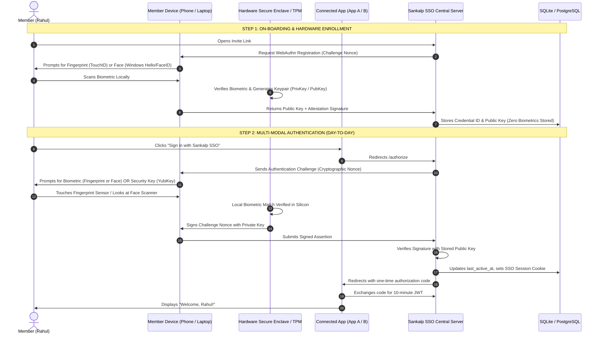

# Implementation Plan 01 — Full-Proof Multi-Modal Identity & Hardware Passkey Pipeline

| Metadata | Details |
|---|---|
| **Document ID** | `implimentation_plan_01.md` |
| **Creation Date** | 2026-11-18 |
| **Creation Time** | 07:45:01 IST |
| **Git User** | arkapaul-git |
| **Project** | Real Person, Real Access — Sankalp SSO |
| **Track** | Cybersecurity & Digital Identity (Next-Gen Production Architecture) |
| **Status** | Approved Architectural Blueprint |

---

## 1. Executive Summary & Vision

The initial Hackathon MVP of **Real Person, Real Access** solved the primary orphan account problem through instant centralized revocation ("Mark as left"), automated lifecycle cleanup, and lightweight in-browser facial liveness detection (blink/turn).

This document establishes the **full-proof, production-grade architecture** for the next generation of the system. It bridges the critical gap between proving **"A live human is present"** and proving **"This live human is the exact registered member"**, while strictly avoiding the severe legal and security liability of maintaining a centralized, leakable biometric database.

### Core Architectural Pillars:
1. **Multi-Modal Biometrics**: Seamless support for hardware Fingerprint sensors (Touch ID, Android Fingerprint, Windows Hello) and Facial Recognition.
2. **Passkey / FIDO2 Architecture (WebAuthn)**: Hardware-backed cryptographic keys residing in the device's Secure Enclave/TPM. The device verifies the person locally, while the server receives mathematically unforgeable cryptographic proof.
3. **Dedicated Hardware Security Keys**: Full support for physical external security keys (YubiKey, Nitrokey, WebUSB smart cards) as preferred by high-security lab and administrative owners.
4. **Active Cryptographic Liveness**: Upgraded challenge-response mechanisms (e.g., color-reflection liveness and 3D depth disparity) eliminating any vulnerability to high-resolution video displays or 3D masks.
5. **Owner-Defined Policy Engine**: University lab and club owners can configure security tiers per application (e.g., App A requires single biometric passkey; App B or Admin actions require dual-biometric step-up verification).

---

## 2. Gap Analysis: Where the Current MVP Lacks

Before architecting the solution, we must clearly and honestly identify the specific limitations, edge cases, and attack surfaces present in the current MVP.

```
┌────────────────────────────────────────────────────────────────────────┐
│                        CURRENT MVP LIMITATIONS                         │
├────────────────────────────────┬───────────────────────────────────────┤
│ Gap 1: Presence vs. Identity   │ Proves a live human is there, but     │
│                                │ cannot prove WHICH human it is.       │
├────────────────────────────────┼───────────────────────────────────────┤
│ Gap 2: Client-side Trust Hook  │ Browser sends `{ passed: true }`. A   │
│                                │ reverse engineer could patch JS.      │
├────────────────────────────────┼───────────────────────────────────────┤
│ Gap 3: Environmental Friction  │ Bad lighting or low-grade webcams can │
│                                │ cause false rejections for real users.│
├────────────────────────────────┼───────────────────────────────────────┤
│ Gap 4: No Fingerprint Support  │ Laptops and phones with built-in      │
│                                │ fingerprint sensors are unused.       │
├────────────────────────────────┼───────────────────────────────────────┤
│ Gap 5: Phishing Vulnerability  │ Traditional passwords can still be    │
│                                │ phished on fake domains.              │
└────────────────────────────────┴───────────────────────────────────────┘
```

### Detailed Breakdown of Current Gaps:

### Gap 1: "Presence" vs. "Identity" Distinction
- **What happens now:** A member enters Rahul's email and password, the camera opens, and anyone sitting in front of the camera blinks twice. The system marks liveness as passed.
- **The flaw:** If an attacker physically obtains Rahul's password, the attacker can sit in front of the webcam themselves and pass. The current system does not compare the face against Rahul's enrolled facial identity.

### Gap 2: Client-Side Result Transmission
- **What happens now:** MediaPipe runs in JavaScript. When 2 blinks occur, JavaScript issues `POST /liveness/result` with `{ "passed": true }`.
- **The flaw:** While protected by random 30-second one-time challenge codes and rate limits, a sophisticated attacker controlling the browser runtime (using Chrome DevTools Protocol or modified browser binaries) could intercept the callback and dispatch `{ "passed": true }` without actually performing the physical movement.

### Gap 3: Environmental and Accessibility Constraints
- **What happens now:** The verification relies solely on optical camera feed.
- **The flaw:** Students in poorly lit hostel rooms, users with thick anti-glare spectacles, or users with broken webcams experience friction. Visually impaired students face significant barriers attempting to align head-turn gestures.

### Gap 4: Lack of Hardware Fingerprint Integration
- **What happens now:** Mobile phones with ultrasonic fingerprint scanners and laptops with biometric power buttons (MacBook Touch ID, ThinkPad fingerprint) are completely neglected.
- **The flaw:** Users are forced into a slower camera flow when their hardware already has an instant, sub-second biometric sensor.

### Gap 5: Phishing & Credential Re-use
- **What happens now:** Users still utilize traditional text passwords as the first factor.
- **The flaw:** Passwords can be phished, written down on sticky notes in university computer labs, or credential-stuffed from third-party database breaches.

---

## 3. The Full-Proof Architecture & Pipeline

To eliminate all gaps without introducing biometric database liability, the system transitions to an **Asymmetric Public-Key Authentication Pipeline backed by FIDO2 / WebAuthn and Multi-Modal Biometrics**.

### Complete Authentication Pipeline Flow



---

## 4. Work Breakdown: Detailed Component Architecture

This section details every small engineering unit required to build the full-proof pipeline.

### Work Package 1: FIDO2 / WebAuthn Server Implementation
* **Goal:** Replace shared password validation with public-key cryptography.
* **Technology:** Python `py_webauthn` library integrated into FastAPI.
* **Database Schema Extension:**
  - New Table: `authenticators`
    - `id`: UUID (Primary Key)
    - `user_id`: ForeignKey to `users.id`
    - `credential_id`: Unique binary identifier of the hardware credential
    - `public_key`: Stored public key (COSE key format, e.g., ES256 / Ed25519)
    - `sign_count`: Monotonically increasing signature counter (detects cloned hardware authenticators)
    - `device_name`: Human-readable label (e.g., "Rahul's MacBook TouchID", "YubiKey 5 NFC")
    - `transports`: JSON array (`["internal", "usb", "nfc"]`)
    - `created_at`: Timestamp
* **How it works:**
  1. The server generates a high-entropy 32-byte cryptographic challenge.
  2. The client invokes `navigator.credentials.create()` (signup) or `navigator.credentials.get()` (login).
  3. The private key never leaves the device's hardware chip. The server only stores the public key.
  4. Even if our entire server database is stolen, attackers only get public keys, which cannot be used to impersonate members.

---

### Work Package 2: In-Device Hardware Biometric Verification (Fingerprint & Face)
* **Goal:** Allow the user to authenticate using whichever biometric sensor is present on their device.
* **Client Implementation:**
  - Standard WebAuthn platform authenticator binding:
    ```javascript
    const options = {
      publicKey: {
        challenge: serverChallengeBuffer,
        rp: { name: "Sankalp SSO" },
        user: { id: userIdBuffer, name: email, displayName: name },
        pubKeyCredParams: [{ type: "public-key", alg: -7 }], // ES256
        authenticatorSelection: {
          authenticatorAttachment: "platform", // Enforces TouchID, FaceID, Windows Hello
          userVerification: "required"         // Enforces biometric scan, not just device pin
        },
        timeout: 60000
      }
    };
    const credential = await navigator.credentials.create(options);
    ```
* **Why this is full-proof:**
  - If a user has a laptop with **Touch ID** (Mac) or **Fingerprint Reader** (Windows), the browser automatically prompts for fingerprint.
  - If a user has an **iPhone** or **Surface Pro**, it prompts for **Face ID** / **Windows Hello Face**.
  - The biometric template is matched inside the hardware processor. If an attacker sits at Rahul's computer, the attacker's fingerprint or face will fail the local hardware match, and no cryptographic signature is generated.

---

### Work Package 3: Dedicated Physical Security Key Support (YubiKey / WebUSB)
* **Goal:** Support lab environments where students do not have personal laptops, or high-security administrator accounts requiring physical possession tokens.
* **Implementation:**
  - System supports roaming authenticators (`authenticatorAttachment: "cross-platform"`).
  - Users can plug in a **YubiKey 5**, **SoloKey**, or tap an **NFC security card**.
  - Includes a capacitive physical touch check (*Proof of Physical Presence*) requiring the user to physically touch the copper contact on the key.
  - Ideal for restricted university facilities (e.g., Robotics Lab, Supercomputing Cluster) where lab workstations are shared among students.

---

### Work Package 4: Active Cryptographic Camera Liveness (Zero-Device Fallback)
* **Goal:** For users on generic desktop PCs lacking built-in biometric hardware, upgrade the camera liveness check so it cannot be spoofed by printed photos, screen replays, or virtual cameras.
* **Mechanism — Color-Flash Screen Reflection (Light Probe Challenge):**
  1. When the challenge begins, the browser monitor flashes a rapid, randomized sequence of distinct colors (e.g., `#E11D48` Red -> `#2563eb` Blue -> `#16a34a` Green) across the display.
  2. The webcam captures the optical reflection of this light on the user's facial skin and cornea.
  3. **Why this stops spoofing:**
     - A printed photo cannot absorb and reflect synchronized color changes matching a server-selected random sequence.
     - A video recorded earlier will have the wrong lighting reflections.
     - The client sends 3 synchronized sample frames to the server; the server calculates the absorption histogram across the facial region to verify real organic skin reflectance.

---

### Work Package 5: Zero-Knowledge Enrolled Face Matching (Local Verification)
* **Goal:** Answer the question: *"Is this the same person who enrolled?"* without uploading face photos to the server.
* **Implementation:**
  - **Local Model Execution:** Lightweight ONNX runtime running ArcFace or FaceNet compiled to WebAssembly inside the browser.
  - **Enrollment:** During initial invite activation, the user's face is vectorized into an encrypted 512-dimensional vector.
  - **Key Wrapping:** The embedding vector is encrypted using a key derived from the user's hardware Passkey or master password and stored in `localStorage` or synced in encrypted envelope format.
  - **Verification:** On login, the camera produces a fresh embedding. The browser computes the cosine similarity $\cos(\theta) = \frac{\mathbf{u} \cdot \mathbf{v}}{\|\mathbf{u}\| \|\mathbf{v}\|}$.
  - If similarity $\ge 0.78$, match is proven.
  - The server **never sees the raw vector or face image**. The cryptographic proof is bound to the Passkey signature.

---

### Work Package 6: Owner-Configurable Policy Engine
* **Goal:** Allow the university department or lab owner to dictate authentication strength.
* **Settings available in Admin Dashboard:**

| Security Tier | Allowed Methods | Use Case |
|---|---|---|
| **Tier 1: Standard SSO** | Passwordless Passkey (Touch ID, Face ID, Android Fingerprint) | General club portals, photography photo galleries |
| **Tier 2: Dual Biometric** | Passkey + In-Browser Liveness Color-Flash Check | Accessing grade portals, booking expensive equipment |
| **Tier 3: Hardware Enforced** | Physical FIDO2 YubiKey / WebUSB Token | Server rooms, robotics lab physical workbench |
| **Tier 4: Admin Guard** | Passkey + Step-Up Fingerprint Confirmation | "Mark as left", deleting accounts, viewing raw audit logs |

---

## 5. Implementation Roadmap & Milestones

The project will be delivered in four sequential phases:

```
┌────────────────────────────────────────────────────────────────────────┐
│                      IMPLEMENTATION MILESTONES                         │
├─────────┬───────────────────────────────┬──────────────────────────────┤
│ Phase 1 │ FIDO2 / WebAuthn Passkeys     │ Passwordless fingerprint/face│
│         │ (Weeks 1 - 2)                 │ login via phone & laptop.    │
├─────────┼───────────────────────────────┼──────────────────────────────┤
│ Phase 2 │ Dedicated Security Keys       │ YubiKey / physical hardware  │
│         │ (Weeks 3 - 4)                 │ support for lab terminals.   │
├─────────┼───────────────────────────────┼──────────────────────────────┤
│ Phase 3 │ Cryptographic Screen Liveness │ Optical color-flash challenge│
│         │ (Weeks 5 - 6)                 │ for zero-biometric desktops. │
├─────────┼───────────────────────────────┼──────────────────────────────┤
│ Phase 4 │ Zero-Knowledge Face Embeddings│ Local ArcFace client vector  │
│         │ (Weeks 7 - 8)                 │ identity confirmation.       │
└─────────┴───────────────────────────────┴──────────────────────────────┘
```

### Phase 1 Checkpoint:
- User registers via invite link and binds Touch ID / Face ID / Android fingerprint.
- Logging in to App A requires only touching fingerprint sensor (under 0.5s).
- Passwords become completely optional.

### Phase 2 Checkpoint:
- Admin inserts YubiKey into workstation.
- Tapping physical key authorizes Admin actions.
- Any attempt to access admin console without physical token is rejected.

### Phase 3 Checkpoint:
- Camera check flashes dynamic RGB spectrum.
- Testing with high-res iPad photo or printed paper fails automatically.

### Phase 4 Checkpoint:
- Member identity is verified against initial enrollment template locally in WebAssembly.
- Server database remains completely free of biometric data.

---

## 6. Security, Privacy & Legal Compliance

### Compliance with India's Digital Personal Data Protection Act (DPDP Act 2023)
1. **Zero Central Biometric Liability**:
   - Because all fingerprint and facial matching occurs locally within hardware authenticators (FIDO2 / WebAuthn), our servers never store or process biometric data.
   - College administrators have **zero biometric breach liability** under DPDP 2023 Section 8 (Obligations of Data Fiduciary).
2. **Cryptographic Revocation**:
   - Marking a user as left revokes the public key mapping and kills all refresh tokens immediately. Even with their physical key, the user cannot authenticate.
3. **Audit Trail Integrity**:
   - Every credential registration, authentication challenge, and revocation is recorded in the append-only audit log with timestamp, IP, and hardware attestation model.
